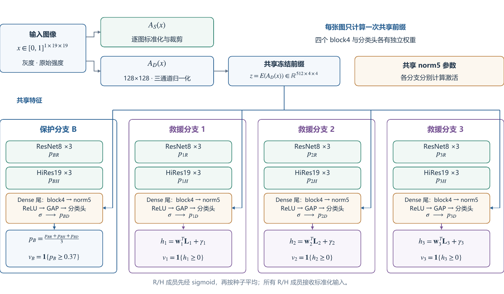

# SCRE-Face

**共享特征条件救援人脸分类模型**（Shared-feature Conditional Rescue Ensemble，固定实现S01）。输入为19×19灰度图，输出人脸`+1`或非人脸`-1`；不做身份识别。使用常规小CNN与监督预训练DenseNet，不使用大模型。



## 结果

| 评价 | 结果 | 来源与口径 |
|---|---:|---|
| 无标签测试集平台Acc | **0.964** | 用户报告，420张；未提供平台逐图真值 |
| 训练原图流程折外准确率 | 98.75%（790/800） | TP400、TN390、FN0、FP10 |
| 内部16视图加权准确率 | 98.0833% | 原图权重0.5，15种退化各1/30 |
| 四压力视图平均准确率 | 97.6875% | 圆盘散焦、JPEG25、椒盐、模糊散斑 |

平台成绩与内部指标使用不同数据和评价口径，不能相互替代。项目曾多轮参考平台和困难样本反馈；0.964不是一次性未触碰盲测声明，不能从四舍五入后的Acc反推准确错误数。测试集没有本地标签，`test_predictions.txt`是模型输出，不能当作真值训练或评分。

## 模型与训练方法

28个评分成员：每个分支包含ResNet8×3、HiRes19×3、DenseNet121×1，共一条初判和三条救援分支。物理存储24个小网络、一个共享Dense冻结前缀/norm5、四个独立block4及分类头，神经参数15,294,620。HiRes19保持19×19网格并结合全局与3×3空间池化；不是HRNet复现。

第一阶段从原图内容和常规增强训练；第二阶段从对应权重继续，以常规图和两种独立退化视图的BCE训练。先划分原图角色，后生成变体。META拟合非负正则logit融合，SEL选择救援阈值。最终为：初判评分≥0.37，或三组救援至少两票为正，即输出人脸。条件执行只计算能影响最终标签的分支，融合权重在部署时固定，不是逐图注意力路由。

0.37来自历史训练集内部八视图网格搜索，当前模型继承此值；[完整阈值来源](docs/threshold_search.md)。[详细方法与证据](docs/full_report.md)、[复现范围](docs/reproduction.md)。

## 快速运行

建议在仓库根目录运行。`requirements.txt`记录归档环境实际版本（Python 3.13.9）；其他PyTorch/NumPy版本或CPU/MPS数值差异应通过预测核验，不能先验保证完全一致。依赖能否安装取决于所用平台与包源。

```bash
python -m venv .venv
source .venv/bin/activate
python -m pip install -r requirements.txt
python scripts/predict.py --device cpu --output outputs/result_S01.txt
python scripts/verify_prediction.py outputs/result_S01.txt
python scripts/recompute_metrics.py
python scripts/replay_threshold.py
```

支持`--device mps`；CPU是默认后端。推理程序没有标签或参考文件入口，决定全部420张图像；验证程序独立比较归档预测，不改写输出。每行格式为`图像编号 空格 ±1`，按1至420递增，无表头。输入MAT恢复必须reshape后交换空间轴，像素已在[0,1]，不得再除255。

## 目录

```text
data/                 用户提供的train.zip、test.zip及MAT
models/s01/           冻结模型、网络定义、校准与哈希元数据
src/scre_face/        移除本机路径及导出依赖的推理实现
scripts/              推理、预测核验、内部指标及历史阈值复算
results/              420行模型预测和用户报告的平台成绩
docs/                 简版PDF、完整图文报告、阈值与复现说明
evidence/             原图划分、训练日志、超参数、消融与折外决策
archive/code/         历史方法代码快照，有上游工作区依赖
MANIFEST.json         发布文件大小与SHA256
```

**复现范围**：本包支持冻结权重推理与保存评分/决策的数值复核。历史训练脚本仍依赖上游工作区检查点和缓存，已明确放入archive，不是一个可从零一键重训全部实验的仓库。没有为打包重训、调参或人工修正测试输出。消融并未证明每个部件不可替代，完整结果包含负面结果。

## 文档与发布

- [实验简报PDF（正文12页，证据附录5页）](docs/SCRE-Face_experiment_brief.pdf)
- [训练与运行协议](docs/reproduction.md)
- [完整报告](docs/full_report.md)
- [平台结果来源](results/platform_result.json)
- [打包与验证记录](evidence/release_validation.json)

重建简版PDF需另装`requirements-report.txt`，并提供本机微软雅黑常规与粗体字体文件；字体不随仓库分发。在仓库根目录执行：

```bash
python -m pip install -r requirements-report.txt
python scripts/build_brief_pdf.py --font /path/to/MicrosoftYaHei.ttc --font-bold /path/to/MicrosoftYaHei-Bold.ttc
```

生成文件为`docs/SCRE-Face_experiment_brief.pdf`。正文数学公式和结构/流程图使用矢量排版，数学字体为STIX，中文为微软雅黑；相关实现见`scripts/report_graphics.py`。重建后仍应检查各页排版；本次交付版已逐页检查。[数学排版修订记录](evidence/pdf_math_revision.json)

解压后可将本目录内容作为GitHub仓库文件提交；此仓库不包含虚拟环境、缓存目录或人工测试标签。本包不另行授予课程数据和第三方预训练资源的再分发许可，数据说明见[data/README.md](data/README.md)。
