# S01最终模型：面向低分辨率与模糊人脸的共享特征、校准救援与条件推理

> **报告范围**：以S01为最终交付模型，依据实际权重、运行代码、训练记录、分折、校准配方和消融记录整理。本文只分析原训练集及其内部评价，图中编号均为训练数据矩阵的原始行号；所有图片中的中文使用**微软雅黑**。本次报告整理没有重新训练或重新选择参数。

## 1. 模型定义与基本流程

S01完成“人脸／非人脸”二分类，不涉及人员身份识别。它由一个**初判分支B**与三个**救援分支**组成，每个分支包含三个ResNet8、三个HiRes19和一个DenseNet121分类成员。模型共保留28个逻辑评分成员，通过共享相同的冻结DenseNet特征模块，实际存储 **15,294,620个神经参数**。

最终决策遵循：初判分支通过就输出人脸；初判未通过时，要求三组救援中至少两组通过。运行时先执行前两组救援，它们结论相同时即可结束，结论不同时再执行第三组。

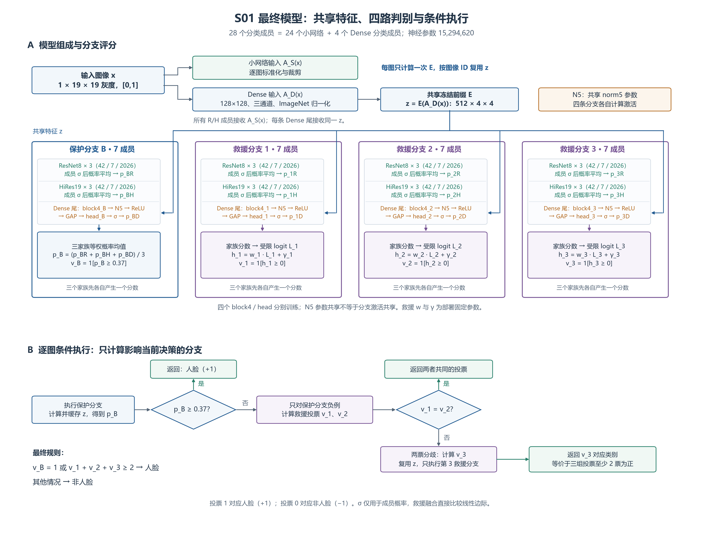

**图1**　S01的完整结构和条件执行。共享的是DenseNet的冻结参数与公共前缀特征；四个可训练尾部具有各自权重。三个小网络种子的概率先在家族内平均，再进入分支决策。

设训练图像为 $x\in[0,1]^{19\times19}$，输出标签为 $\widehat y\in\{-1,+1\}$。$+1$为人脸，$-1$为非人脸。对分支 $j\in\{B,1,2,3\}$、家族 $k\in\{R,H,D\}$，定义

$$
p_{jk}(x)=\frac1{|S_k|}\sum_{s\in S_k}
\sigma\bigl(f_{jks}(x)\bigr),\qquad
S_R=S_H=\{42,7,2026\},\quad S_D=\{42\},
$$

其中 $\sigma(z)=1/(1+e^{-z})$。初判概率为

$$
p_B(x)=\frac{p_{BR}(x)+p_{BH}(x)+p_{BD}(x)}3,
\qquad B(x)=\mathbb1[p_B(x)\ge0.37].
$$

对救援分支，将三个家族概率转为经过裁剪的logit $l_{jk}(x)$，执行

$$
h_j(x)=\sum_{k\in\{R,H,D\}}w_{jk}l_{jk}(x)+\gamma_j,
\qquad v_j(x)=\mathbb1[h_j(x)\ge0].
$$

最终规则为

$$
\widehat y(x)=
\begin{cases}
+1,&B(x)=1\;\lor\;\displaystyle\sum_{j=1}^{3}v_j(x)\ge2,\\
-1,&\text{其他情况}.
\end{cases}
$$

**这里没有一个可以直接解释为“最终人脸概率”的统一输出。** $p_B$是初判分数，$h_j$是线性决策边际，最后由逻辑关系给出标签。救援的零阈值与初判的0.37处于不同数值空间，不能相互替代。

## 2. 原训练数据与可视化分析

### 2.1 数据规模与标签

$$
\mathcal D=\{(x_i,y_i)\}_{i=1}^{800},\qquad
x_i\in[0,1]^{19\times19},\quad y_i\in\{-1,+1\}.
$$

| 项目 | 核验结果 |
| --- | --- |
| 图像文件及矩阵 | `train_data.mat`中的`train_data`，800×361，原存储float64 |
| 标签文件 | `train_label.mat`，800个±1标签 |
| 人脸 / 非人脸 | 400 / 400 |
| 恢复后张量 | 800×1×19×19，float32 |
| 像素范围 | [0,1]；没有非有限像素 |
| 像素完全相同的原图 | 未发现；800张均不同 |
| 描述性像素均值 / 标准差 | 约0.4176 / 0.2129，不作为全局归一化参数 |

没有身份、拍摄来源等分组元数据，因此像素去重不能证明不同角色中的人物或场景完全独立。[数据核验](../evidence/训练数据核验.json)

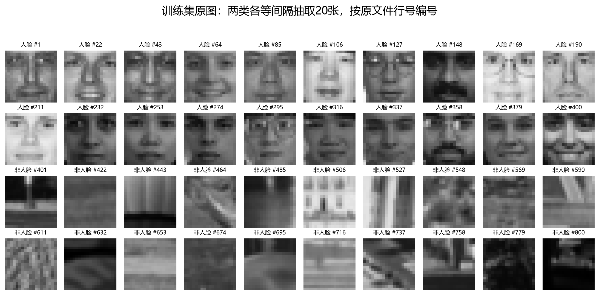

**图2**　两类各按原始编号等间隔抽取20张。原图采用最近邻放大展示，显示面积增大不会增加真实细节。

### 2.2 强度、纹理与空间布局

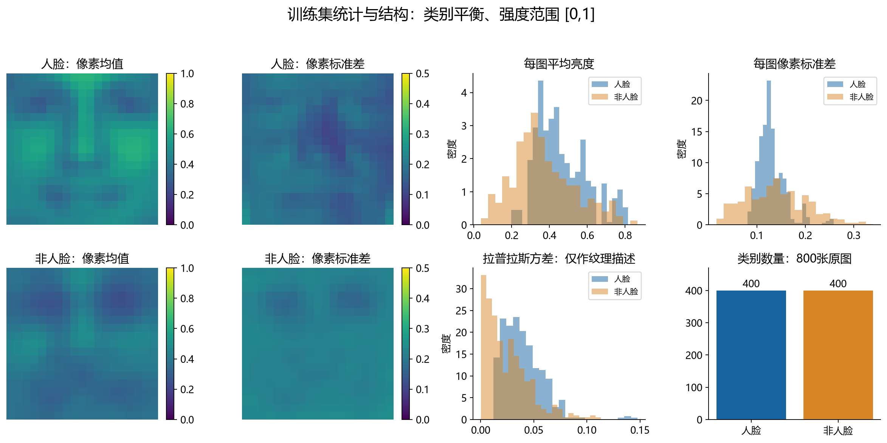

**图3**　类别均值、逐像素标准差和每图描述统计。人脸均值图呈现较一致的粗布局，非人脸纹理更分散；这只是类别总体特征，不表示每张图都具有相同姿态和对齐。

统计量定义为

$$
m_i=\frac1{361}\sum_{u,v}x_i(u,v),\qquad
s_i=\sqrt{\frac1{361}\sum_{u,v}[x_i(u,v)-m_i]^2},\qquad
q_i=\operatorname{Var}[\Delta x_i].
$$

拉普拉斯 $\Delta$ 在每张19×19图像的两个空间轴上独立计算，不跨原图编号轴。$q_i$同时受到纹理、边缘、噪声和模糊影响，不能当作真实模糊标签。S01没有把这些统计量输入融合器，也没有依据它们手工分流。

### 2.3 低频信息的描述性分析

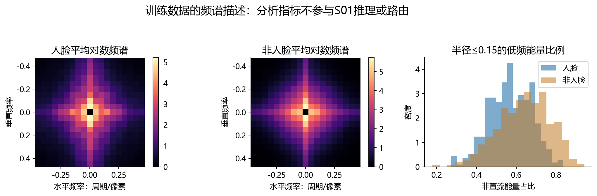

**图4**　减去每图均值后，计算二维离散傅里叶功率谱；右图统计半径不超过0.15周期/像素的非直流能量比例。该半径仅用于此处数据分析，不是S01的滤波截止频率或可训练参数。

$$
X_i(a,b)=\sum_{u,v}[x_i(u,v)-m_i]
e^{-2\pi\mathrm i(au/19+bv/19)},\qquad
\rho_i=\frac{\sum_{0<\|\boldsymbol f\|\le0.15}|X_i(\boldsymbol f)|^2}
{\sum_{\|\boldsymbol f\|>0}|X_i(\boldsymbol f)|^2+\varepsilon}.
$$

人脸结构可以在低频区域留下线索，但非人脸也可能具有平滑结构。不能凭低频占比高就判为人脸。**S01没有频谱分解支路**；该分析解释低分辨率结构与退化问题，不增加模型计算流程。

## 3. 原图划分、校准与评价协议

### 3.1 先划分原图，再生成增强视图

对同一分类器—校准器配对，使用下列角色：

| 角色 | 用途 |
| --- | --- |
| FIT | 更新神经网络可训练参数 |
| ES | 依据验证BCE选择第一、二阶段检查点 |
| META | 拟合分数标准化统计量、融合系数与截距 |
| SEL | 对冻结的融合评分选择分类阈值 |
| OUT | 对应流程的外层评价 |

同一配对的五种原图集合两两不交；一张原图及其所有退化版本始终属于同一角色。交叉验证允许同一原图在不同配对中承担不同角色，隔离要求应逐配对检查。

### 3.2 训练集内部三折流程评价

800张原图首先分层三折，每折外层266或267张。剩余533或534张内部再组成三个配对，每组神经拟合约284张、ES71或72张、META118张、SEL59或60张。该外折图像不参加对应新增专家、融合或阈值的拟合与选择。

三个外折拼接得到800张原图的折外（OOF）判断。每张原图还产生16标准视图和4保留压力视图。16,000个评价项共享800个来源，不能视为16,000个独立样本。

### 3.3 最终部署的参数角色

初判分支使用800张原图进行固定轮次拟合；轮次由训练集内部记录决定，不用全量拟合误差选择。三组救援分别采用426、426、427张FIT原图，ES均107张；其余原图分为META178／178／177和SEL89／89／89。部署保留各权重与其校准参数的对应关系。

| 用途 | 配对 | FIT | ES | META | SEL | 外层评价 |
| --- | --- | --- | --- | --- | --- | --- |
| 流程评价 | o1p1 | 284 | 71 | 118 | 60 | 267 |
| 流程评价 | o1p2 | 284 | 71 | 118 | 60 | 267 |
| 流程评价 | o1p3 | 284 | 72 | 118 | 59 | 267 |
| 流程评价 | o2p1 | 284 | 71 | 118 | 60 | 267 |
| 流程评价 | o2p2 | 284 | 71 | 118 | 60 | 267 |
| 流程评价 | o2p3 | 284 | 72 | 118 | 59 | 267 |
| 流程评价 | o3p1 | 284 | 72 | 118 | 60 | 266 |
| 流程评价 | o3p2 | 284 | 72 | 118 | 60 | 266 |
| 流程评价 | o3p3 | 284 | 72 | 118 | 60 | 266 |
| 最终部署 | deploy1 | 426 | 107 | 178 | 89 | 0 |
| 最终部署 | deploy2 | 426 | 107 | 178 | 89 | 0 |
| 最终部署 | deploy3 | 427 | 107 | 177 | 89 | 0 |

[完整原图划分](../evidence/原图划分完整记录.json)。这些角色规模也解释了为何需要区分“流程评价”与“最终部署权重评价”：外折专家的拟合样本较少，最终部署使用的初判和救援权重并非外折评价中的同一组权重。

此外，架构与初判0.37来自同一训练数据较早的内部开发。本项目也经过多轮探索。因此下文准确表述为**训练集内部流程评价**，不是全新数据上的完全独立泛化认证。

## 4. 数据预处理

### 4.1 还原图像方向

图像行向量采用MATLAB式展开方向，实际代码为：

```python
def image(a):
    return torch.from_numpy(
        a.reshape(-1,19,19).transpose(0,2,1).copy()
    ).float()[:,None]
```

训练和推理必须一致交换空间轴，不能只做`reshape`。输入统一为float32、单通道、19×19。

### 4.2 小网络逐图标准化

ResNet8和HiRes19各自使用

$$
\mu_x=\frac1{HW}\sum x(u,v),\qquad
\sigma_x=\sqrt{\frac1{HW}\sum[x(u,v)-\mu_x]^2},
$$

$$
\widetilde x(u,v)=\operatorname{clip}\left(
\frac{x(u,v)-\mu_x}{\max(\sigma_x,0.01)},-3,3\right).
$$

它减轻绝对亮度和对比度差异；标准差下限和裁剪控制极端数值。低对比图中的噪声仍可能被放大，因此需要退化训练配合。

### 4.3 DenseNet输入与共享前缀

Dense路径保留原强度，双线性插值到128×128，复制为三通道，并按ImageNet统计归一化：

$$
\widetilde x_c=\frac{\operatorname{Resize}_{128}(x)-\mu_c}{s_c},\quad
\boldsymbol\mu=(0.485,0.456,0.406),\quad
\boldsymbol s=(0.229,0.224,0.225).
$$

插值适配网络输入，不恢复已经丢失的细节。相同输入经过共享前缀 $E$ 得到

$$
z(x)=E(\widetilde x)\in\mathbb R^{512\times4\times4}.
$$

四个Dense尾部按各自权重处理该特征。特征只需生成一次；不同block4后的特征不能互相替代。

```python
# 节选本模型使用的预处理规则
if kind != 'densenet121':
    x = ((x-x.mean((2,3),keepdim=True)) /
         x.std((2,3),correction=0,keepdim=True).clamp_min(.01)).clamp(-3,3)
else:
    x = F.interpolate(x,(128,128),mode='bilinear',
                      align_corners=False).repeat(1,3,1,1)
    x = (x-x.new_tensor([.485,.456,.406])[None,:,None,None]) / \
        x.new_tensor([.229,.224,.225])[None,:,None,None]
```

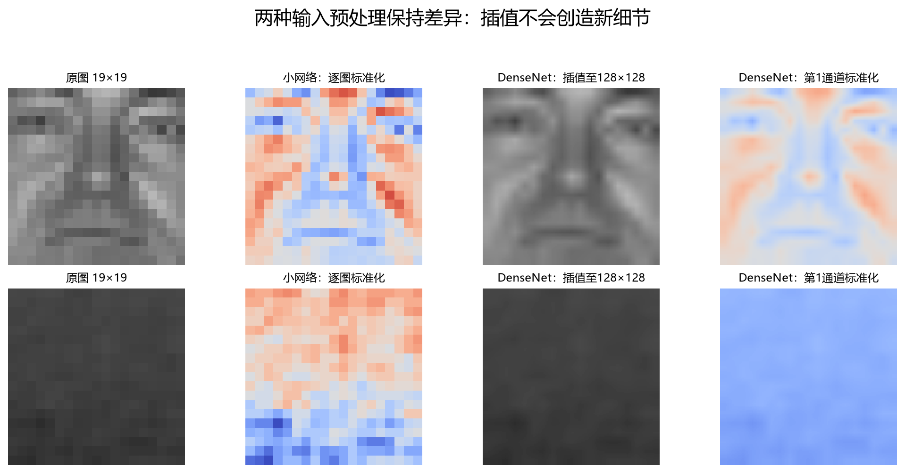

**图5**　两个输入体系。伪彩色仅显示标准化后的数值，不表示模型接收额外颜色信息。[完整预处理实现](../archive/code/networks.py)

## 5. 网络结构及共享参数组织

### 5.1 最终模型的实际组成

| 组件 | 数量 | 单个或合计参数 | 功能 |
| --- | --- | --- | --- |
| ResNet8 | 12 | 每个78,529；合计942,348 | 低分辨率残差特征 |
| HiRes19 | 12 | 每个76,673；合计920,076 | 保持19×19空间网格与粗布局 |
| Dense冻结共享前缀 | 1 | 4,793,728 | 公共监督预训练特征 |
| 共享末端norm5 | 1 | 2,048 | 固定归一化参数与运行统计 |
| 独立denseblock4 | 4 | 每个2,158,080；合计8,632,320 | 各分支可训练特征尾部 |
| Dense二分类头 | 4 | 每个1,025；合计4,100 | 各分支分类输出 |
| **神经参数总计** | — | **15,294,620** | 不含BN缓冲区、激活和校准元数据 |

按float32神经参数计算约58.34 MiB；实际权重文件还包括缓冲区、门控配置和序列化信息，不能用该数字代替文件大小或峰值内存。

四个Dense分支的共享前缀与norm5由逐张量键、形状、类型和内容核验确定相同。共享norm5意味着使用相同的固定参数，但各分支仍需对自身block4输出执行norm5。

### 5.2 ResNet8：原生低分辨率残差建模

$$
1\times19\times19
\xrightarrow{3\times3,16}16\times19\times19
\xrightarrow{\mathrm{Res}(16,16,1)}16\times19\times19
\xrightarrow{\mathrm{Res}(16,32,2)}32\times10\times10
\xrightarrow{\mathrm{Res}(32,64,2)}64\times5\times5
\xrightarrow{\mathrm{Flatten,Dropout}(0.2),\mathrm{FC}}\mathbb R.
$$

残差块满足

$$
h_{l+1}=\operatorname{ReLU}\{F_l(h_l)+S_l(h_l)\}.
$$

$F_l$是两层3×3卷积、GroupNorm与激活，$S_l$是恒等映射或匹配步长/通道的1×1投影。残差学习有利于优化，但本任务的小型结构仍需要自己的数据证据。[ResNet原论文](https://arxiv.org/abs/1512.03385)

小容量和原生19×19输入适合当前样本规模；两次下采样又可能损失微弱结构，不能把残差连接本身等同于去模糊。

### 5.3 HiRes19：保持网格和多尺度粗结构

HiRes19先用3×3卷积映射到32通道，再通过膨胀率1、2、3的三个残差块，每块含两层3×3卷积，始终保持19×19网格。膨胀卷积可写为

$$
(W*_dh)(u,v)=\sum_{a,b}W(a,b)h(u+da,v+db).
$$

末端拼接全局均值与3×3空间区域均值：

$$
\phi(h)=\left[\frac1{HW}\sum_{u,v}h(u,v);\;
\left\{\frac1{|B_{ab}|}\sum_{(u,v)\in B_{ab}}h(u,v)\right\}_{a,b=0}^{2}\right]
\in\mathbb R^{320}.
$$

实际19像素轴的区域为`[0:7]`、`[6:13]`、`[12:19]`，遵循自适应平均池化分区，有一像素重叠。分类头是`320→64→1`，中间ReLU和Dropout0.2。

```python
self.features = nn.Sequential(
    conv(1,32), DilatedBlock(32,1),
    DilatedBlock(32,2), DilatedBlock(32,3))
self.head = nn.Sequential(
    nn.Linear(320,64), nn.ReLU(),
    nn.Dropout(.2), nn.Linear(64,1))
```

它希望表达眼、鼻、嘴之间的粗相对位置；这是自定义小网络，不是原版HRNet，也不包含显式低频分解。高分辨率网格仍可能保留噪声，膨胀采样也可能有栅格效应。

两个小网络均使用4组GroupNorm，统计不依赖batch维。GroupNorm的功能依据与本任务实测贡献应区分；本轮未单独重训比较所有归一化种类。[Group Normalization原论文](https://arxiv.org/abs/1803.08494)

### 5.4 DenseNet121：监督迁移与独立尾部

DenseNet通过通道拼接复用前层特征：

$$
h_l=H_l([h_0,h_1,\ldots,h_{l-1}]).
$$

其密集块层数为6、12、24、16，增长率32。128×128输入经过前缀得到512×4×4，block4再得到1024×4×4，随后norm5、ReLU、全局均值池化和二分类头。[DenseNet原论文](https://arxiv.org/abs/1608.06993)

采用常规ImageNet监督预训练初始化，每个Dense分支仅更新block4与新二分类头，共2,159,105参数。全部BN运行统计固定；block4中BN仿射参数仍更新，norm5参数冻结。小网络随机初始化。

因此，“本任务拟合和选型只依赖原训练集”不意味着Dense全部初始权重都从这800张随机学得。预训练来源与冻结范围必须披露。

三家族的互补动机分别来自小容量残差、空间布局和监督迁移/强度路径；它们在本数据上的作用由消融评估，而不是由架构名称决定。S01没有可学习的逐图家族权重或注意力模块。

## 6. 两阶段训练与分支专长

### 6.1 第一阶段：原图内容与常规增强

将标签变换为 $t_i=(y_i+1)/2$。使用稳定的二元logit交叉熵：

$$
\ell(z,t)=\log(1+e^z)-tz,\qquad
\mathcal L_1=\frac1B\sum_{i=1}^{B}\ell(f_\theta(A(x_i)),t_i).
$$

第一阶段以原训练图像为内容基础，使用旋转±0.12弧度、平移约±0.8像素、0.5概率翻转、增益[0.5,1.5]、偏移[-0.1,0.1]与σ=0.015高斯噪声，裁剪到[0,1]。它不是逐像素完全不变的训练，但不使用第二阶段的严重复合退化策略。

### 6.2 初判分支的第二阶段

初判分支从对应第一阶段检查点继续优化。常规增强后，以0.5概率加入基础退化，每次每原图一个视图，使用BCE。基础退化包括高斯σ∈{0.5,1,1.5}、双线性降至9/12/15再回19，或高斯σ0.5/1加降至12/15再回19。

### 6.3 救援分支的第二阶段

各救援成员从对应第一阶段最佳检查点开始，生成常规视图 $c_i=A_0(x_i)$ 和两个独立复合退化视图：

$$
d_i^{(1)}=T_i^{(1)}(c_i),\quad d_i^{(2)}=T_i^{(2)}(c_i),
$$

$$
\mathcal L_2=\frac1{3B}\sum_{i=1}^{B}
\left[\ell(f_\theta(c_i),t_i)
+\ell(f_\theta(d_i^{(1)}),t_i)
+\ell(f_\theta(d_i^{(2)}),t_i)\right].
$$

正常/退化训练权重为1/3与2/3。两个退化共享常规几何视图，但退化采样独立；两类图像使用相同策略，避免把“有模糊”变成人脸标签捷径。

```python
clean = base_view(x[ii])
d1, d2 = corrupt(clean), corrupt(clean)
images = torch.cat([clean,d1,d2])
targets = target[ii].repeat(3)
logits = net(prep(images.to(device),kind)).flatten()
loss = F.binary_cross_entropy_with_logits(logits,targets.to(device))
```

常规视图保留弱几何和翻转，增益[0.8,1.2]、偏移[-0.05,0.05]。每次退化均匀抽取五种基础类型之一、强度 $s\sim U(0.5,1)$：无基础空间滤波、高斯、任意方向运动、高斯后降采样、降采样。还叠加对比度、噪声、可选弱模糊和JPEG，改变噪声与滤波顺序。具体范围列入超参数账本。

### 6.4 为什么有助于模糊结构识别

理想高斯模糊的频率响应为

$$
x_{\mathrm{blur}}=h_\sigma*x,\qquad
\widehat x_{\mathrm{blur}}(\boldsymbol f)
=\exp[-2\pi^2\sigma^2\|\boldsymbol f\|^2]\widehat x(\boldsymbol f).
$$

高频衰减更明显，粗空间布局相对保留。对同一内容的常规和退化视图施加相同监督，可减少对易消失细纹理的依赖；HiRes19的空间表达和其他家族提供不同证据。

这是一种机制解释，不表示模型恢复了丢失的细节。噪声、运动和强模糊也会破坏粗结构；S01仍可能漏检，必须同时报告成功和失败样本。

## 7. 验证损失、检查点与实际训练轮次

### 7.1 固定16视图与保留压力视图

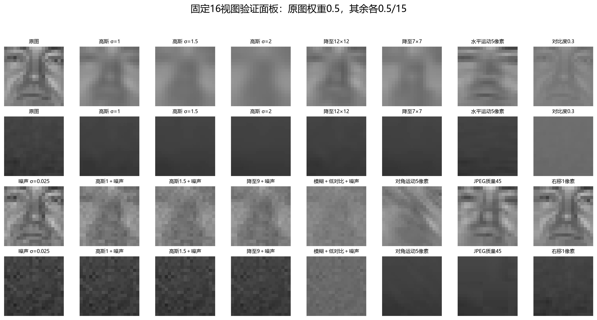

**图6**　标准16视图。原图权重为0.5，其余15种各为1/30，用于阶段2ES、META和SEL的相应目标。

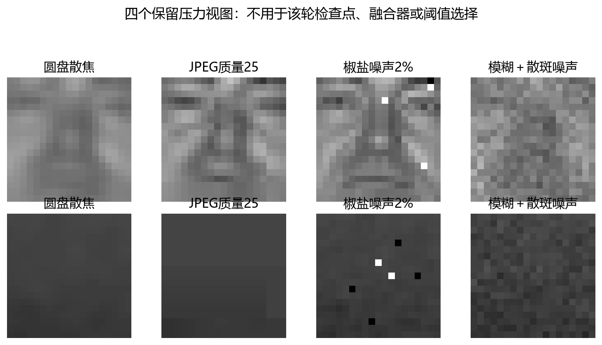

**图7**　圆盘散焦、JPEG25、椒盐噪声、模糊＋散斑作为保留压力视图，不用于本轮检查点、融合器或阈值选择。它们与增强可能有物理相似性，不等于所有退化机制从未见过。

训练梯度使用`BCEWithLogits`；实际验证和固定诊断先把概率裁剪到 $[10^{-6},1-10^{-6}]$：

$$
\widehat p_{vi}=\operatorname{clip}(p_\theta(T_vx_i),10^{-6},1-10^{-6}),
$$

$$
\mathcal L_{\mathrm{ES,16}}=
\sum_{v=0}^{15}\omega_v\frac1{n_{\mathrm{ES}}}\sum_i
\left[-t_i\log\widehat p_{vi}-(1-t_i)\log(1-\widehat p_{vi})\right],
\quad \omega_0=\tfrac12,\quad\omega_{v>0}=\tfrac1{30}.
$$

第一阶段使用ES原图BCE；第二阶段使用上述16视图加权BCE。在第1轮、每个偶数轮和最后一轮检查，保存最低BCE权重；代码执行满阶段上限再恢复检查点，不是patience提前终止。

### 7.2 优化器与学习率

| 设置 | ResNet8 | HiRes19 | DenseNet121 |
| --- | --- | --- | --- |
| 阶段1初始LR | 0.001 | 0.001 | 0.0001 |
| 阶段2初始LR | 0.0001 | 0.0001 | 0.00003 |
| 折内阶段1执行上限 | 80 | 80 | 30 |
| 折内阶段2执行上限 | 40 | 40 | 20 |
| 原图batch上限 | 64 | 64 | 32 |

使用AdamW、weight decay0.001，默认betas=(0.9,0.999)、eps=1e-8；阶段切换时重新建立优化器。余弦学习率为

$$
\eta_e=\frac{\eta_0}{2}\left[1+\cos\frac{\pi(e-1)}{T_{\max}}\right].
$$

折内 $T_{\max}$ 为阶段上限；初判最终全800固定长度拟合的 $T_{\max}$ 为实际执行轮数。救援三视图使每批前向图像数至多约192、192、96。**这些初始LR和上限是预设，不是逐项搜索所得。**

### 7.3 真实配对曲线

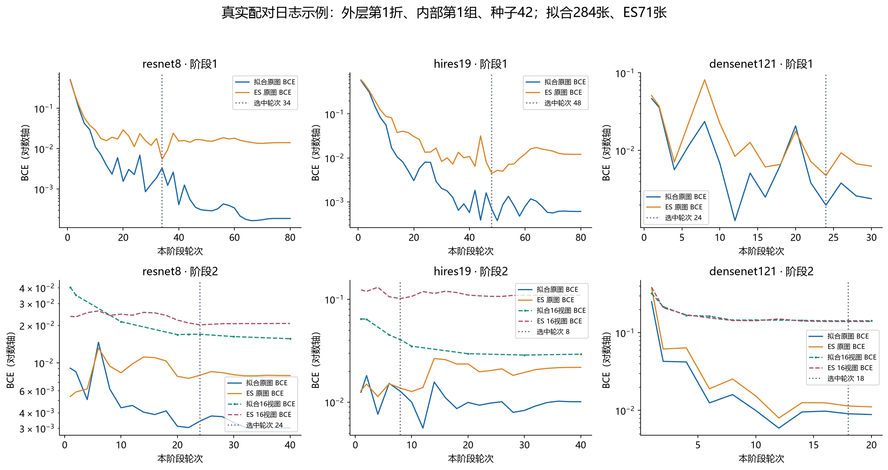

**图8**　流程评价外折1、内部配对1、种子42，FIT284张、ES71张。第一行为阶段1、第二行为救援阶段2；每个点来自真实日志。固定退化拟合BCE仅在部分轮次记录，连线不表示中间轮次都有测量。

比较拟合与验证时应匹配视图口径：原图对原图，固定16视图对固定16视图。在线随机增强目标与固定原图损失输入分布不同，二者差距不能直接当作泛化差距。

验证BCE可能因少量高置信错误而上升。例如真实人脸的分数由0.9变成0.01时，其BCE从约0.105变为4.605。训练损失继续下降不意味着应该无限加轮次，应由ES决定检查点。

初判最终全800记录没有逐轮验证历史，本文没有为它补造曲线。图8是对应训练流程的真实嵌套记录，不冒充最终全量拟合过程。

### 7.4 全部28个分类成员的轮次

“选中/执行”分开列出：如6/30表示实际运行30轮、保存第6轮。初判全800按来源折的家族中位轮次固定执行，没有全量ES；救援保留各自ES所选权重。

| 分支 | 架构 | 种子 | 阶段1选中/执行 | 阶段2选中/执行 |
| --- | --- | --- | --- | --- |
| 初判B | resnet8 | 42 | 52/52 | 28/28 |
| 初判B | resnet8 | 7 | 52/52 | 28/28 |
| 初判B | resnet8 | 2026 | 52/52 | 28/28 |
| 初判B | hires19 | 42 | 60/60 | 26/26 |
| 初判B | hires19 | 7 | 60/60 | 26/26 |
| 初判B | hires19 | 2026 | 60/60 | 26/26 |
| 初判B | densenet121 | 42 | 6/6 | 4/4 |
| 救援1 | resnet8 | 42 | 62/80 | 32/40 |
| 救援1 | resnet8 | 7 | 60/80 | 28/40 |
| 救援1 | resnet8 | 2026 | 52/80 | 24/40 |
| 救援1 | hires19 | 42 | 50/80 | 40/40 |
| 救援1 | hires19 | 7 | 64/80 | 40/40 |
| 救援1 | hires19 | 2026 | 60/80 | 20/40 |
| 救援1 | densenet121 | 42 | 6/30 | 18/20 |
| 救援2 | resnet8 | 42 | 70/80 | 20/40 |
| 救援2 | resnet8 | 7 | 50/80 | 18/40 |
| 救援2 | resnet8 | 2026 | 56/80 | 24/40 |
| 救援2 | hires19 | 42 | 68/80 | 20/40 |
| 救援2 | hires19 | 7 | 44/80 | 24/40 |
| 救援2 | hires19 | 2026 | 32/80 | 24/40 |
| 救援2 | densenet121 | 42 | 2/30 | 20/20 |
| 救援3 | resnet8 | 42 | 30/80 | 34/40 |
| 救援3 | resnet8 | 7 | 44/80 | 20/40 |
| 救援3 | resnet8 | 2026 | 42/80 | 34/40 |
| 救援3 | hires19 | 42 | 50/80 | 20/40 |
| 救援3 | hires19 | 7 | 62/80 | 14/40 |
| 救援3 | hires19 | 2026 | 78/80 | 36/40 |
| 救援3 | densenet121 | 42 | 10/30 | 18/20 |

三个救援DenseNet的阶段2实际执行20轮，分别选中18、20、18轮。不能把某个分支的轮数直接套到全部Dense成员。[成员及父权重清单](../evidence/28网络部署权重与轮次.json)

## 8. 校准器训练：由META学习证据组合

### 8.1 概率与logit的数值规则

家族种子先平均sigmoid概率，不平均原始logit。救援特征按R/H/D顺序计算：

$$
\bar p_{jk}=\operatorname{clip}(p_{jk},10^{-5},1-10^{-5}),\qquad
l_{jk}=\operatorname{clip}\left(\log\frac{\bar p_{jk}}{1-\bar p_{jk}},-8,8\right).
$$

裁剪防止极端置信产生无穷值。成员概率、种子均值及logit先采用float32，随后升float64进行融合；这一顺序属于实际数值实现。

### 8.2 META标准化与类别平衡损失

对每组META原图数 $n$，标准化使用每原图等权和视图权重：

$$
\mu_k=\sum_v\frac{\omega_v}{n}\sum_i l_{vik},\quad
s_k=\max\left(0.05,\sqrt{\sum_v\frac{\omega_v}{n}\sum_i(l_{vik}-\mu_k)^2}\right),\quad
z_{vik}=\frac{l_{vik}-\mu_k}{s_k}.
$$

这一步不按类别平衡；拟合损失另使用

$$
\beta_{vi}=\omega_v\begin{cases}1/(2n_+),&t_i=1,\\1/(2n_-),&t_i=0.\end{cases}
$$

学习目标为

$$
\min_{\boldsymbol a,b}
\sum_{v,i}\beta_{vi}\left[\log(1+e^{u_{vi}})-t_i u_{vi}\right]
+0.01\sum_k a_k^2,\qquad u_{vi}=b+\sum_k a_kz_{vik},
$$

$$
0\le a_k\le4,\qquad -4\le b\le4.
$$

这是特征固定后的凸约束问题，使用L-BFGS-B、解析梯度、maxiter300、ftol1e-12。截距不受L2惩罚，初始三个系数均1/3、截距0。0.01、上下界、容差均为预设，并未经过λ网格搜索。

```python
def objective(theta):
    z = Xstd @ theta[:-1] + theta[-1]
    error = beta * (expit(z)-target)
    loss = beta @ (np.logaddexp(0,z)-target*z)
    loss += .01*np.sum(theta[:-1]**2)
    grad = np.r_[Xstd.T@error+.02*theta[:-1],error.sum()]
    return float(loss),grad
```

分数变大影响救援判断，但学习到的系数在部署时固定；它们不是针对每张图像重新生成的专家权重。系数也不要求加和为1，不能直接作为架构贡献百分比。

## 9. 分类阈值、部署边际与零阈值的含义

### 9.1 初判阈值0.37的来源

该设置来自早期原训练集内部的640/160划分、8视图开发选择：原图权重0.5、其他7种各0.5/7，阈值候选为0.01至0.99共99点，最大化加权准确率；同分先距0.5近、再选较小者。

$$
\tau_B^*=\arg\max_{\tau\in\{0.01,0.02,\ldots,0.99\}}
\sum_{v=0}^{7}\omega_v^{\mathrm{dev}}\operatorname{Acc}_v(\tau)=0.37.
$$

S01继承并冻结该值，没有重新联合搜索整个最终级联。因此它有训练集内部选择来源，但不能称为当前全部模块的联合全局最优阈值。[搜索实现快照](../archive/code/historical_threshold_search.py)

### 9.2 救援阈值来自独立SEL

META拟合结束后，冻结融合器，以辅助分数 $g_j=\sigma(u_j)$ 在独立SEL原图的16视图上选择 $\tau_j$：

$$
\mathrm{BA}_v(\tau)=\frac12\left[
\frac{\sum_{i:t_i=1}\mathbb1[g_j(T_vx_i)\ge\tau]}{n_+}
+\frac{\sum_{i:t_i=0}\mathbb1[g_j(T_vx_i)<\tau]}{n_-}\right],
$$

$$
\tau_j^*=\arg\max_\tau\sum_{v=0}^{15}\omega_v\mathrm{BA}_v(\tau).
$$

实际代码枚举不同分数之间的区间中点、边界区间中点及0/1，覆盖可达分类划分。同分按最差视图BA、原图BA、区间宽度、距0.5距离、较小阈值和稳定索引依次选择，指标比较保留12位小数。

| 救援组 | META原图 | SEL原图 | 训练选择的τ | 候选数 | 等价区间宽度 | SEL加权BA |
| --- | --- | --- | --- | --- | --- | --- |
| 1 | 178 | 89 | 0.4964241985554285 | 1203 | 0.00380713671 | 98.3215% |
| 2 | 178 | 89 | 0.42197594976043606 | 1214 | 3.34078338e-05 | 98.5051% |
| 3 | 177 | 89 | 0.28338009073713283 | 1180 | 0.00115274479 | 98.8333% |

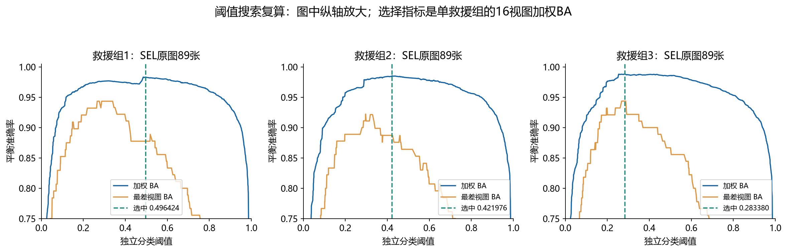

**图9**　SEL上的阈值选择曲线；纵轴放大到0.75—1显示差异。它是选择过程，不是独立评价。每组89张原图的16视图仍只有89个独立来源。

长小数来自相邻分数中点，不代表统计精确到十几位。第2组等价区间仅约3.34×10⁻⁵，说明小样本阈值稳定性仍需关注。阈值目标是单个救援分支的BA，没有联合优化整个逻辑级联。

### 9.3 S01的实际边际参数

将训练所得统计、系数和SEL阈值合成为

$$
w_{jk}=a_{jk}/s_{jk},\qquad
\gamma_j=b_j-\sum_k a_{jk}\mu_{jk}/s_{jk}-\operatorname{logit}(\tau_j).
$$

由sigmoid严格单调性，

$$
g_j(x)\ge\tau_j\iff h_j(x)=\sum_k w_{jk}l_{jk}(x)+\gamma_j\ge0.
$$

| 救援组 | w_R | w_H | w_D | γ |
| --- | --- | --- | --- | --- |
| 1 | 0.216995217530 | 0.193462832544 | 0.151992944164 | -0.260556828666 |
| 2 | 0.206824596474 | 0.178610543136 | 0.179468497019 | 0.073615676587 |
| 3 | 0.219164466478 | 0.184801430332 | 0.167869739633 | 0.550165720821 |

表值为便于阅读保留12位小数，实际模型保存原浮点数。**零是定义好的决策边界，不是重新搜索的分类阈值，也不表示人脸概率为0。** 成员网络本身的sigmoid仍用于生成家族概率；S01主融合路径不再显式计算辅助 $g_j$。

```python
clipped = np.asarray(families,dtype=np.float32).clip(1e-5,1-1e-5)
L = np.log(clipped/(1-clipped)).clip(-8,8).astype(np.float64)
margin = L @ weights + decision_bias
decision = margin >= 0
```

真实运行器在 $|h_j|$ 很接近零时，按相对数值容差回退到训练表述的比较，保留边界数值行为。模型同时保存校准来源信息用于回退与审计，并非只保存表中的12个标量。[实际运行器](../archive/code/c1_shared_runtime.py)

## 10. 条件执行的实现与数学性质

### 10.1 共享特征与短路代码

以下是与实际运行器控制逻辑一致的核心摘录，网络构建和完整边界处理见代码文件：

```python
encoded = shared_dense_prefix(preprocess_dense(images))
positive = score_initial_branch(images,encoded) >= .37
pending = np.flatnonzero(~positive)
if len(pending):
    v1 = rescue_vote(1,images,encoded,pending)
    v2 = rescue_vote(2,images,encoded,pending)
    same = v1 == v2
    positive[pending[same]] = v1[same]
    disputed = pending[~same]
    if len(disputed):
        positive[disputed] = rescue_vote(3,images,encoded,disputed)
labels = np.where(positive,1,-1)
```

若前两票相同，第三票无论为何都不改变多数结果；如果前两票不同，第三票直接决定多数。这是输入相关的执行路径，**不是根据图像质量学习权重的注意力路由**。

### 10.2 初判保留规则的作用与代价

初判正例集合包含于最终正例集合：

$$
\{x:B(x)=1\}\subseteq\{x:\widehat y(x)=+1\}.
$$

因此相对于单独初判分支，救援不会新增漏检，但也不能纠正初判已有的误报，并可能新增误报。总体准确率变化取决于救回真脸与新增误报的数量差。

非负 $w_{jk}$ 保证其他特征固定时，提高某家族证据不会降低 $h_j$；这是一项结构先验，不自动构成其不可替代性的实测证明。

### 10.3 源图流程中的执行路径分布

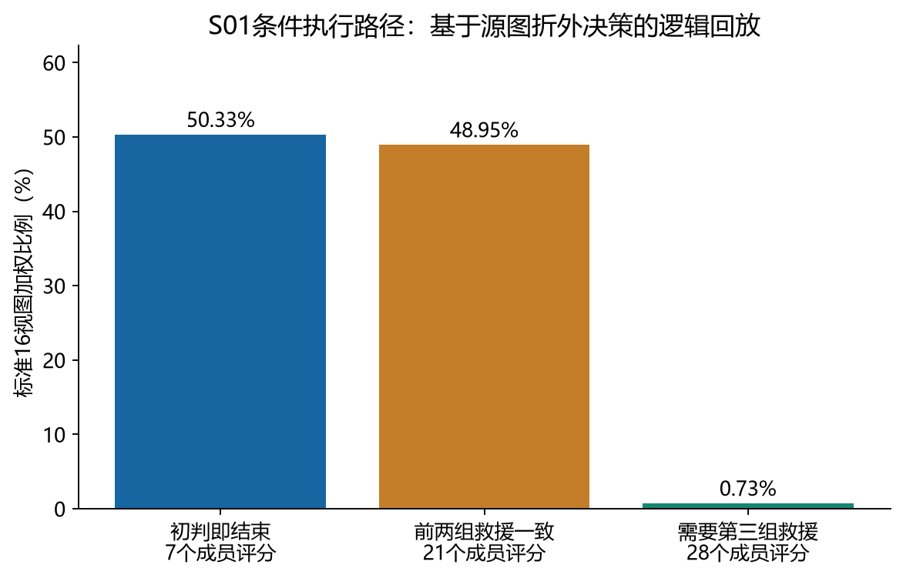

**图10**　根据800张原图的外层折外分数回放条件逻辑，在标准16视图加权下，约50.325%由初判结束、48.946%由前两组救援一致结束、0.729%需要第三组救援。

每图逻辑成员调用数为

$$
N(x)=7+14\mathbb1[B(x)=0]
+7\mathbb1[B(x)=0\land v_1(x)\ne v_2(x)].
$$

该面板加权均值约14.0055。它是源图决策回放的逻辑计数，不是GPU耗时；共享Dense前缀后不同成员成本不同，不能把成员数量直接换算成延迟。

## 11. 超参数如何确定：完整账本

网络权重和融合系数属于**参数拟合**；检查点和阈值属于**内部选择**；结构、LR、增强范围等大多是**固定预设**；初判阈值等属于**有训练集来源的继承设置**。这些概念必须区分。下面按实际记录说明，不将未经搜索的参数写成已寻优。

### 超参数与参数来源完整账本

本节只说明S01当前采用的设置及其来源。“已使用”不等于“已证明最优”。按以下四类区分：

| 类型 | 定义 | S01中的典型项目 |
| --- | --- | --- |
| 固定 | 预先规定的结构、数值、流程或计算规则，本轮不搜索其候选值 | 架构、学习率、增强范围、L2强度、投票数 |
| 拟合 | 用指定原训练子集更新参数，或计算统计估计 | FIT上的神经权重；META上的均值、尺度、融合系数和截距 |
| 选择 | 在预先规定的候选范围中，按内部验证准则选取 | ES选择检查点；SEL选择救援阈值 |
| 继承 | 使用已有、具有明确来源的初始化或内部开发设置 | ImageNet监督预训练；初判阈值0.37；初判全800训练轮数 |

#### 1. 模型结构、输入与数值保护

| 项目 | 实际设置 | 来源类别与说明 |
| --- | --- | --- |
| 数据与标签 | 800张19×19灰度原图；人脸、非人脸各400；标签−1/+1；训练标签映射为0/1 | 固定：原数据格式 |
| 图像方向恢复 | 每行361维先恢复19×19，再交换两个空间轴；float32，单通道 | 固定：与MAT存储方向一致 |
| 初判/保护分支 | ResNet8三种子＋HiRes19三种子＋DenseNet121单种子 | 继承的三家族配方，当前固定 |
| 救援分支 | 三个独立权重—校准器配对；每组同样包含上述三个家族 | 固定：每组独立训练和校准 |
| 小网络种子 | ResNet8、HiRes19均为42、7、2026 | 固定：没有按成绩挑选最佳随机种子 |
| DenseNet种子 | 每分支均为42 | 固定 |
| ResNet8通道与网格 | 卷积stem 1→16；残差块16→16、16→32、32→64；步长1、2、2；网格19→19→10→5 | 固定；未搜索宽度、深度或步长 |
| ResNet8卷积与头部 | stem及主分支3×3；匹配维度的skip投影1×1；展平64×5×5，Dropout0.2，单logit线性输出 | 固定 |
| HiRes19通道与卷积 | stem 1→32；三个32通道残差块，每块两层3×3；膨胀率依次1、2、3；全程19×19 | 固定；不是可学习频率切分 |
| HiRes19池化与头部 | GAP32维与3×3空间区域均值288维拼接；320→64→1；ReLU；Dropout0.2 | 固定；19像素轴上的池化区间为[0:7]、[6:13]、[12:19]，存在重叠 |
| 小网络规范化 | GroupNorm，4组，eps为运行库默认1e−5，具有可学习仿射参数 | 组数/eps固定；仿射参数由FIT拟合 |
| DenseNet121 | 密集块层数6、12、24、16；增长率32；1024维末端特征；新建1024→1分类头 | 继承标准结构；分类头任务化 |
| DenseNet初始化 | 常规ImageNet监督预训练权重；文件densenet121-a639ec97.pth；SHA256为a639ec97d7c33b07ae66f0b5fb7d0192f95a3b11b7576c66c0126c2a727c4395 | 继承；并非全部初始权重都从800张图像随机训练获得 |
| DenseNet更新范围 | 仅denseblock4与新分类头更新；其余参数冻结；末端norm5参数冻结 | 固定微调范围；更新部分由FIT拟合 |
| DenseNet BN | 所有BatchNorm运行均值/方差固定；block4内部BN可学习缩放和偏置仍可更新 | 固定统计使用规则；未搜索解冻策略 |
| S01参数共享 | 一个Dense冻结前缀、共享norm5参数、四个独立block4＋分类头；24个独立小网络 | 固定实现；共享的张量已经逐项核验一致，不是重新联合训练共享编码器 |
| S01神经参数量 | 唯一参数15,294,620；纯float32参数约58.3443MiB | 由结构及已保存权重确定；不等于峰值运行内存 |
| 小网络输入 | 逐图减均值，除以总体标准差（correction=0）；标准差下限0.01；裁剪至[−3,3] | 统计量按当前图像计算；下限/裁剪固定 |
| DenseNet输入 | 保留原始[0,1]强度；bilinear插值128×128，align_corners=False；灰度复制三通道 | 固定；插值不增加原始图像信息 |
| DenseNet输入规范 | 均值(0.485,0.456,0.406)，标准差(0.229,0.224,0.225) | 继承ImageNet输入规范 |
| 神经训练损失 | BCEWithLogits；正负类不另加类别权重 | 固定；神经阶段与融合器阶段的类别加权不同 |
| ES记录的BCE数值保护 | 先将sigmoid概率裁剪至[1e−6,1−1e−6]，再计算BCE | 固定；它与训练时直接使用logit的BCE实现要区分 |
| 救援融合概率保护 | 家族概率裁剪至[1e−5,1−1e−5]，取logit，再裁剪至[−8,8] | 固定；未搜索裁剪值 |
| 融合计算精度 | 保留原float32概率均值和logit舍入，再以float64执行校准/线性判别 | 固定复现规则 |
| 融合尺度下限 | 0.05 | 固定；实际均值和尺度仅用META估计 |
| 条件执行顺序 | 先初判；其为正则返回；否则运行救援1、2；两票相同则返回，不同再运行救援3 | 固定逻辑规则，不是按图像生成融合权重 |
| 临界数值回退 | 线性边际绝对值不超过$10^{-10}(1+\sum_k\lvert l_k\rvert\lvert w_k\rvert+\lvert\gamma_j\rvert)$时，回退到保存的校准评分与阈值比较 | 固定数值保护，不是分类阈值搜索 |
| 推理batch默认值 | 64 | 固定运行默认值；主要控制执行批量，不是用来选择分类边界的参数 |

小网络输入严格为

$$
\widetilde x=\operatorname{clip}
\left(\frac{x-\mu_x}{\max(\sigma_x,0.01)},-3,3\right),
\quad
\sigma_x^2=\frac1{361}\sum_{u,v}(x(u,v)-\mu_x)^2.
$$

#### 2. 两阶段优化设置与真实检查点规则

| 项目 | ResNet8 | HiRes19 | DenseNet121 | 来源 |
| --- | --- | --- | --- | --- |
| 第一阶段初始学习率 | 0.001 | 0.001 | 0.0001 | 固定；没有搜索学习率候选 |
| 第二阶段初始学习率 | 0.0001 | 0.0001 | 0.00003 | 固定；没有搜索学习率候选 |
| 折内第一阶段执行上限 | 80轮 | 80轮 | 30轮 | 固定预算 |
| 折内第二阶段执行上限 | 40轮 | 40轮 | 20轮 | 固定预算 |
| 原图batch上限 | 64 | 64 | 32 | 固定；按原图计，不按三视图后的张数计 |
| 优化器 | AdamW | AdamW | AdamW | 固定 |
| weight decay | 0.001 | 0.001 | 0.001 | 固定；未进行wd候选搜索 |
| AdamW betas | (0.9,0.999) | (0.9,0.999) | (0.9,0.999) | 使用运行库默认值，未单独搜索 |
| AdamW eps | 1e−8 | 1e−8 | 1e−8 | 使用运行库默认值 |
| 学习率调度 | 每阶段余弦衰减 | 每阶段余弦衰减 | 每阶段余弦衰减 | 固定协议 |
| 阶段切换 | 新建优化器和调度器 | 同左 | 同左 | 不延续第一阶段优化器动量状态 |
| 第一阶段检查点 | ES原图BCE最低 | 同左 | 同左 | 内部选择 |
| 第二阶段检查点 | ES固定16视图加权BCE最低 | 同左 | 同左 | 内部选择 |
| 检查时间 | 第1轮、每个偶数轮、最后一轮 | 同左 | 同左 | 固定；只从实际检查过的轮次中选 |
| 相同ES损失处理 | 严格小于才替换，因而保留先前检查点 | 同左 | 同左 | 固定 |
| 训练是否执行满上限 | 折内均执行满上限，再恢复最佳权重 | 同左 | 同左 | 不是patience提前终止 |

实现按原图数$N$划成$\lceil N/B\rceil$个近等长批，实际批量不一定恰好为64或32。救援第二阶段每批再拼接正常、退化1、退化2三个视图，所以前向图像数约为原图批量的三倍。

折内第$e$轮开始时的学习率为

$$
\eta_e=\frac{\eta_0}{2}
\left[1+\cos\left(\frac{\pi(e-1)}{T_{\max}}\right)\right].
$$

折内$T_{\max}$为该阶段上限。初判/保护分支的全800张固定长度训练，$T_{\max}$则为其继承的实际训练轮数。

**第一阶段和第二阶段采用不同的训练输入与损失聚合。**

| 分支/阶段 | 输入与损失 | 来源 |
| --- | --- | --- |
| 全部分支第一阶段 | 原图经常规增强；每图一个视图；普通BCE | 固定训练协议 |
| 初判/保护分支第二阶段 | 从对应第一阶段权重继续；先常规增强，再以0.5概率加入高斯模糊、降采样或二者组合；每图一个视图；BCE | 继承并固定的分支训练路线 |
| 救援分支第二阶段 | 从对应第一阶段权重继续；一个常规视图及两个独立退化视图；三个BCE等权 | 固定训练协议；无第三阶段专家训练 |

救援第二阶段的实际目标为

$$
\mathcal L_2
=\frac1{3B}\sum_{i=1}^{B}
\left[
\ell(f_\theta(c_i),t_i)
+\ell(f_\theta(T_i^{(1)}c_i),t_i)
+\ell(f_\theta(T_i^{(2)}c_i),t_i)
\right],
\quad
\ell(z,t)=\log(1+e^z)-tz.
$$

名义正常/退化损失比例为$1/3$与$2/3$。不能将验证面板的原图0.5权重写成该训练目标的正常视图权重。

#### 3. 最终分支采用的训练轮数

初判/保护分支的全800张训练没有ES：先在内部原图分折中选择检查点，再按同家族所选轮数中位数确定固定长度训练。救援分支则保留各自ES选出的检查点。下表每格为“阶段1→阶段2”。

| 架构 | 种子 | 初判/保护分支：实际固定轮数 | 救援1：选中轮数 | 救援2：选中轮数 | 救援3：选中轮数 |
| --- | --- | --- | --- | --- | --- |
| ResNet8 | 42 | 52→28 | 62→32 | 70→20 | 30→34 |
| ResNet8 | 7 | 52→28 | 60→28 | 50→18 | 44→20 |
| ResNet8 | 2026 | 52→28 | 52→24 | 56→24 | 42→34 |
| HiRes19 | 42 | 60→26 | 50→40 | 68→20 | 50→20 |
| HiRes19 | 7 | 60→26 | 64→40 | 44→24 | 62→14 |
| HiRes19 | 2026 | 60→26 | 60→20 | 32→24 | 78→36 |
| DenseNet121 | 42 | 6→4 | 6→18 | 2→20 | 10→18 |

救援小网络的第一/二阶段分别实际运行80/40轮；DenseNet分别运行30/20轮。例如“2→20”中的2表示第一阶段30轮执行中的最佳检查点，不表示第一阶段只运行2轮。

#### 4. 训练增强全部范围

第一阶段常规增强，所有类别使用同一分布：

| 操作 | 实际范围或概率 | 来源 |
| --- | --- | --- |
| 旋转 | Uniform[−0.12,+0.12]弧度，约±6.88° | 固定 |
| 横纵平移 | normalized坐标各±1.6/19，在align_corners=False下约±0.8像素 | 固定 |
| 几何采样与边界 | 双线性grid sampling，边界复制 | 固定 |
| 水平翻转 | 概率0.5 | 固定 |
| 强度增益 | Uniform[0.5,1.5] | 固定 |
| 强度偏移 | Uniform[−0.1,0.1] | 固定 |
| 高斯噪声 | 标准差0.015 | 固定 |
| 输出范围 | clip至[0,1] | 固定 |

初判/保护分支第二阶段，在上述增强后，以0.5概率加入一种空间退化；三种基础类型均匀抽取：

| 类型 | 实际参数 | 来源 |
| --- | --- | --- |
| 高斯模糊 | $\sigma\in\{0.5,1,1.5\}$ | 固定 |
| 降采样 | bilinear降至9/12/15，再bilinear恢复19×19 | 固定 |
| 高斯＋降采样 | $\sigma\in\{0.5,1\}$，再降至12/15并恢复19×19 | 固定 |

救援分支第二阶段先生成常规视图$c=A_0(x)$：

| 操作 | 实际范围或概率 | 来源 |
| --- | --- | --- |
| 几何与翻转 | 与第一阶段相同的弱旋转/平移/边界处理和0.5水平翻转 | 固定 |
| 强度增益 | Uniform[0.8,1.2] | 固定 |
| 强度偏移 | Uniform[−0.05,0.05] | 固定 |
| 常规视图输出 | clip至[0,1]；本步骤自身不额外加入高斯噪声 | 固定 |

对同一$c$独立调用两次退化函数：

| 部分 | 实际范围或概率 | 来源 |
| --- | --- | --- |
| 调用强度 | 每次调用$s\sim U(0.5,1)$ | 固定分布；不是可学习参数 |
| 每样本基础类型 | 五类均匀抽取 | 固定 |
| 类型0 | 不做基础空间滤波，但仍可执行下列对比度/噪声/压缩 | 固定 |
| 类型1 | 高斯模糊，$\sigma\in\{0.5,0.8,1.2,1.6\}\times s$ | 固定 |
| 类型2 | 运动模糊，方向Uniform[0,$\pi$]，核长度3或5 | 固定 |
| 类型3 | 上述高斯模糊＋降采样 | 固定 |
| 类型4 | 降采样 | 固定 |
| 降采样大小 | 8/10/12/15；降采样方式bilinear或area；再bilinear恢复19×19 | 固定 |
| 对比度 | $a\in\{1,0.75,0.5,0.35\}$，按$(x-0.5)a+0.5$变换 | 固定；围绕灰度0.5，不是逐图均值 |
| 附加噪声 | $\sigma_n\in\{0,0.005,0.01,0.02,0.03\}\times s$ | 固定 |
| 处理顺序 | 等概率选择“对比度/噪声→可选弱模糊”或“可选弱模糊→对比度/噪声” | 固定 |
| 额外弱模糊 | $\sigma\in\{0.4,0.7\}$；上述第一种顺序出现概率0.35，第二种0.25 | 固定 |
| JPEG | 概率0.2；quality45/65/85 | 固定 |
| 输出范围 | clip至[0,1] | 固定 |
| 类别处理 | 人脸和非人脸使用相同增强分布 | 固定 |

两次退化共享同一常规几何视图，但各自随机调用。空间滤波、JPEG和处理顺序的部分参数按当前类型子批抽样，噪声与对比度幅度按样本抽样；不能把代码中的全部随机量都描述为每张图独立抽取。

高斯滤波使用反射边界，核半径为$\lceil3\sigma\rceil$，核按离散高斯归一化；运动模糊使用反射边界。上述所有强度、概率与大小均未逐项搜索。

#### 5. 标准验证面板与保留压力面板

第一阶段检查点只看ES原图BCE。第二阶段ES、融合META及阈值SEL使用固定16视图协议：

| 序号 | 标准视图 | 参数 |
| --- | --- | --- |
| 0 | 原图 | 不退化 |
| 1 | 高斯模糊 | $\sigma=1$ |
| 2 | 高斯模糊 | $\sigma=1.5$ |
| 3 | 高斯模糊 | $\sigma=2$ |
| 4 | 降采样 | area式自适应区域平均至12×12，再bilinear恢复19×19 |
| 5 | 降采样 | 同上，降至7×7 |
| 6 | 水平运动模糊 | 5像素均值核 |
| 7 | 低对比度 | $0.3x+0.35$ |
| 8 | 高斯噪声 | $\sigma_n=0.025$ |
| 9 | 高斯＋噪声 | $\sigma=1,\sigma_n=0.025$ |
| 10 | 高斯＋噪声 | $\sigma=1.5,\sigma_n=0.025$ |
| 11 | 降采样＋噪声 | 降至9×9，$\sigma_n=0.02$ |
| 12 | 模糊＋低对比＋噪声 | $0.35\,G_1(x)+0.325+0.015\epsilon$ |
| 13 | 对角运动模糊 | 5×5主对角线上均值核 |
| 14 | JPEG | quality45 |
| 15 | 位移 | 向右1像素，边界复制 |

视图权重固定为

$$
\omega_0=\frac12,\qquad
\omega_v=\frac1{30}\quad(v=1,\ldots,15).
$$

标准噪声由局部随机生成器seed807123产生，同一批图像的噪声张量供各含噪视图按不同幅度复用。它是固定可复现的评价实现，**原图顺序和生成批次也是噪声对应关系的一部分**。源图评估保留原外折顺序；校准按META原图再SEL原图的拼接顺序一次生成视图，再切角色。

四个保留压力视图如下，每项权重1/4：

| 压力视图 | 参数 | 用途 |
| --- | --- | --- |
| 圆盘散焦 | 5×5核，radius1.5，核内均匀，反射边界 | 仅统计当轮保留压力表现 |
| JPEG | quality25 | 同左 |
| 椒盐噪声 | 像素随机数<0.01置0、>0.99置1，总概率2% | 同左 |
| 模糊＋乘性散斑 | $\operatorname{clip}(G_{1.2}(x)(1+0.10\epsilon),0,1)$ | 同左 |

椒盐与散斑使用局部生成器seed8813。四压力视图不用于当轮检查点、META拟合或SEL选择；它们与训练增强具有物理相关性，不宜表述为“所有退化机制都从未出现过”。

#### 6. 原图分折、角色比例与随机种子

| 层次/用途 | 实际设置 | 来源 |
| --- | --- | --- |
| 原外层划分 | StratifiedKFold，3折，shuffle=True，random_state=20261112 | 固定 |
| 原外层训练池 | 533/533/534张 | 由分折产生 |
| 初判源评估与部署救援的FIT | 426/426/427张 | 原外层训练池再划分 |
| 原ES | 每折107张；test_size=0.2；分层；random_state=871＋fold | 固定比例和种子 |
| 嵌套救援的内部3折 | 在对应外层训练池内；shuffle=True；random_state=9120＋outer | 固定 |
| 嵌套救援FIT/ES | FIT284；ES71或72；ES比例0.2；random_state=5340＋10×outer＋pair | 固定比例和种子 |
| 嵌套META/SEL | 校准池按2/3与1/3分层；META118；SEL59或60；random_state=7180＋10×outer＋pair | 固定 |
| 最终救援META/SEL | 原外折校准池按2/3与1/3分层；random_state=8810＋fold | 固定 |
| 最终救援META原图数 | 178/178/177 | 由分折产生 |
| 最终救援SEL原图数 | 每组89 | 由分折产生 |
| 初判全800训练 | 使用内部选轮数中位数确定固定轮数，不另设全800 ES | 继承内部选择结果 |

同一配对内FIT、ES、META、SEL、OUT原图ID两两不交。先划分原图，后生成退化变体。不同交叉验证配对允许同一原图担任不同角色，不能将所有组FIT合并后再误判其应与所有组META完全不交。

随机性复现还包括以下已固定流：

| 用途 | 实现中的seed规则 |
| --- | --- |
| 常规第一阶段初始化 | seed＋7000 |
| 原初判第二阶段及嵌套救援第二阶段初始化流程 | seed＋14000；第二阶段载入对应第一阶段权重 |
| 原初判/嵌套救援原图打乱 | NumPy Generator(seed＋113×phase) |
| 最终救援第二阶段原图打乱 | NumPy Generator(seed＋226) |
| 每阶段逐batch增强随机流 | seed＋100000×phase＋1000×epoch＋batch_index |
| 标准面板噪声 | 807123 |
| 保留压力面板噪声 | 8813 |

这些种子是预设复现规则，不是经外层成绩搜索选出的最优随机种子。

#### 7. META融合目标与求解器

先在家族内平均sigmoid概率。R、H各平均三个种子，D单种子；救援融合特征顺序固定为R/H/D。

$$
p_{jk}(x)=\frac1{|S_k|}\sum_{s\in S_k}
\sigma(f_{jks}(x)),\quad
S_R=S_H=\{42,7,2026\},\quad S_D=\{42\}.
$$

将概率按第1节裁剪并取logit，得到$l_{vik}$。对某组META原图数$m$，标准化参数为

$$
\mu_k=\sum_v\frac{\omega_v}{m}\sum_{i=1}^m l_{vik},
\qquad
s_k=\max\left(0.05,
\sqrt{\sum_v\frac{\omega_v}{m}
\sum_{i=1}^m(l_{vik}-\mu_k)^2}\right),
\qquad
z_{vik}=\frac{l_{vik}-\mu_k}{s_k}.
$$

**标准化按原图等权、按视图加权，没有类别平衡。** 类别平衡只出现在融合器拟合损失中。若META中正负数为$m_+,m_-$，

$$
\beta_{vi}=\omega_v
\begin{cases}
1/(2m_+),&t_i=1,\\
1/(2m_-),&t_i=0.
\end{cases}
$$

拟合问题严格为

$$
\min_{\boldsymbol a,b}
\sum_{v,i}\beta_{vi}
\bigl[\log(1+e^{u_{vi}})-t_i u_{vi}\bigr]
+0.01\sum_{k=1}^{3}a_k^2,
\quad
u_{vi}=b+\sum_{k=1}^{3}a_kz_{vik},
$$

$$
0\le a_k\le4,\qquad -4\le b\le4.
$$

| 项目 | 实际值 | 来源 |
| --- | --- | --- |
| 融合输入 | 三个家族的裁剪logit，顺序R/H/D | 固定 |
| 标准化均值/尺度 | 上式，仅META | 拟合：统计估计 |
| 融合系数与截距 | 每组3个$a_k$与1个$b$，无系数和为1约束 | 拟合：有界优化 |
| 类别加权 | 两类各占总权重1/2，再乘视图权重 | 固定 |
| Ridge强度 | 0.01；目标为$0.01\sum a_k^2$，不是$0.01\lVert\theta\rVert^2/2$ | 固定，未搜索 |
| 截距正则 | 不惩罚截距 | 固定 |
| 系数边界 | [0,4] | 固定，未搜索 |
| 截距边界 | [−4,4] | 固定，未搜索 |
| 初始化 | 三个系数均1/3，截距0 | 固定 |
| 求解器 | L-BFGS-B，解析梯度 | 固定 |
| maxiter | 300 | 固定 |
| ftol | 1e−12 | 固定 |
| 收敛检查 | 要求求解器返回success | 固定核验 |
| 输入相关权重 | 无；学得系数部署时固定 | 模型定义 |

因此，S01学习的是全局分数融合，不是逐图产生$a_k(x)$的动态专家路由。

#### 8. SEL阈值搜索与同分规则

融合器在META拟合后冻结，只在该组SEL上搜索救援阈值。主目标为16视图加权平衡准确率：

$$
J(\tau)=\sum_{v=0}^{15}\omega_v
\frac{\operatorname{TPR}_v(\tau)+
\operatorname{TNR}_v(\tau)}2.
$$

| 项目 | 实际规则 | 来源 |
| --- | --- | --- |
| 分类比较 | 分数$\ge\tau$判为人脸 | 固定 |
| 搜索精度 | float64 | 固定 |
| 候选集合 | 不同分数之间的区间中点、两端区间中点及0/1端点，覆盖可达到的分类划分 | 固定搜索空间 |
| 首要目标 | 最大化16视图加权BA | 固定 |
| 首要同分处理 | 主目标按12位小数比较 | 固定数值规则 |
| 后续同分顺序1 | 最差视图BA更高 | 固定 |
| 后续同分顺序2 | 原图BA更高 | 固定 |
| 后续同分顺序3 | 无分类变化的阈值等价区间更宽 | 固定 |
| 后续同分顺序4 | 更接近0.5 | 固定 |
| 后续同分顺序5 | 阈值更低，再按稳定索引 | 固定 |
| 完整级联是否联合优化 | 否；每组独立优化自己的BA | 现有流程限制 |

三组最终救援阈值为：

| 救援分支 | META原图 | SEL原图 | 选中阈值 | 候选数 | 选中区间宽度 |
| --- | --- | --- | --- | --- | --- |
| 1 | 178 | 89 | 0.4964241985554285 | 1203 | 0.0038071367102202047 |
| 2 | 178 | 89 | 0.42197594976043606 | 1214 | 0.000033407833845533474 |
| 3 | 177 | 89 | 0.28338009073713283 | 1180 | 0.0011527447929741141 |

阈值的长小数来自相邻预测分数的中点，不代表参数已经获得十几位的统计精度。89张原图的16视图也没有变成1424张独立来源。三个阈值不能平均成一个全局阈值，也不能称为完整级联的联合最优解。

#### 9. 初判/保护阈值0.37的来源与继承限制

初判分支先在家族内平均种子概率，再对R、H、D三个家族等权平均：

$$
p_B(x)=\frac{p_{BR}(x)+p_{BH}(x)+p_{BD}(x)}3,
\qquad
B(x)=\mathbb1[p_B(x)\ge0.37].
$$

0.37可追溯到原训练集较早的内部开发：640张拟合、160张验证；验证采用8视图——原图、Gaussian1/1.5/2、降采样12/7、水平运动5、对比度0.3；原图权重0.5，其余7类各0.5/7。阈值搜索网格为

$$
\mathcal T_0=\{0.01,0.02,\ldots,0.99\},
\qquad
\tau_0^*=\arg\max_{\tau\in\mathcal T_0}
\sum_{v=0}^{7}\omega_v^{\mathrm{hist}}
\operatorname{Acc}_v(\tau).
$$

同分先选更接近0.5者，再选较小者。历史锁定记录确认R/H/D家族等权、七成员配方选中0.37；架构/融合候选另外按加权准确率、最差视图准确率、加权BCE、网络数、名称排序。

S01当前初判权重采用了后续训练集内部重训结果，**0.37则作为具有历史内部开发依据的固定设置继承，没有针对当前全部权重重新搜索**。因此可以说明其可追溯来源，但不能称其已被证明是当前完整模型的全局最优阈值。该历史开发也意味着后续同一训练数据上的评估并非完全没有选择偏差。

#### 10. S01的零阈值与最终决策

对救援分支$j$，META/SEL确定的原评分与阈值为

$$
g_j(x)=\sigma\left(
b_j+\sum_k a_{jk}
\frac{l_{jk}(x)-\mu_{jk}}{s_{jk}}
\right),
\qquad g_j(x)\ge\tau_j.
$$

定义

$$
w_{jk}=\frac{a_{jk}}{s_{jk}},
\qquad
\gamma_j=b_j-\sum_k\mu_{jk}w_{jk}
-\operatorname{logit}(\tau_j),
$$

即可写成

$$
h_j(x)=\sum_k w_{jk}l_{jk}(x)+\gamma_j,
\qquad v_j(x)=\mathbb1[h_j(x)\ge0].
$$

**这里的0是代数变换后对原边界的定义，不是又搜索或训练出的新分类阈值。** 融合系数、标准化统计和原阈值都已吸收到$w_j,\gamma_j$；临界浮点区域仍按保存的评分公式回退比较。

S01最终规则为

$$
\widehat y(x)=
\begin{cases}
+1,& B(x)=1\ \lor\ \sum_{j=1}^{3}v_j(x)\ge2,\\
-1,&\text{其余情况}.
\end{cases}
$$

“至少2票”与“初判为正即保留”是预先固定的结构规则，不是损失函数学出的参数；本流程没有证明2票对所有评价目标都最优。最终输出是这一逻辑决策，没有额外定义或认证一个统一后验概率。

#### 11. 对“全部参数都优化过”的准确说明

可以说：**任务神经权重、META融合参数经过拟合，检查点和救援阈值通过对应内部角色选择；其余大量结构与优化设置是固定或继承的。**

不能说“所有参数均进行了最优搜索”。尤其学习率、weight decay、架构宽度、退化强度、正则0.01和投票数没有系统候选搜索；检查点是在既定训练预算与检查时刻内选择，阈值是在既定分数与SEL目标下选择。它们与全局最优、跨划分稳定或每个部件不可替代，是不同的结论。


## 12. S01分类结果可视化

### 12.1 原图混淆矩阵与正确样本

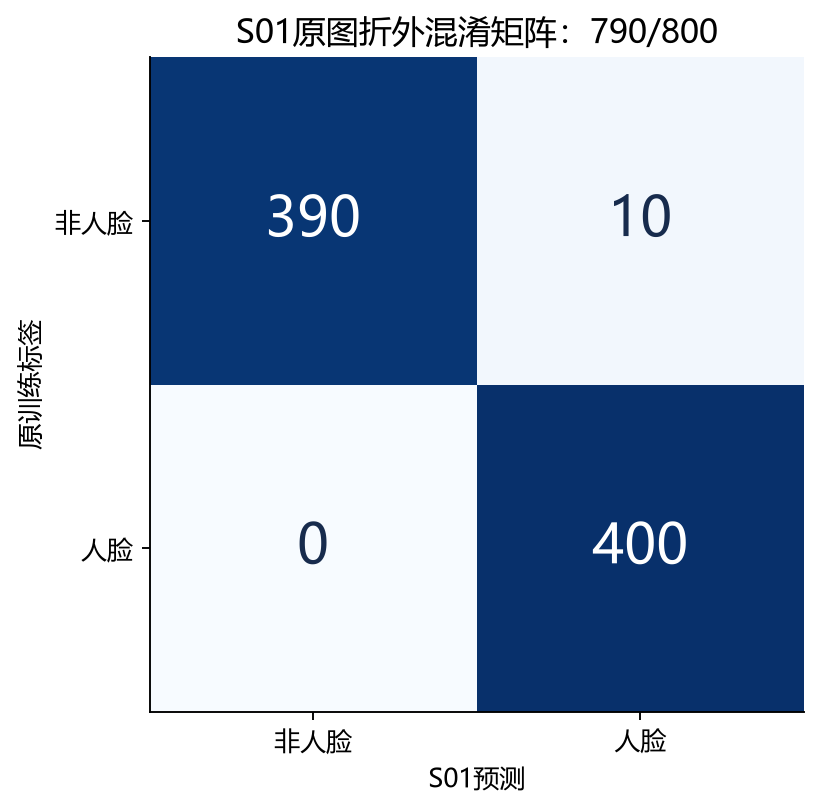

**图11**　训练原图的流程折外评价：TP400、FN0、TN390、FP10，790/800正确，准确率98.75%；人脸召回100%，非人脸特异度97.5%，人脸预测精确率400/410≈97.561%。

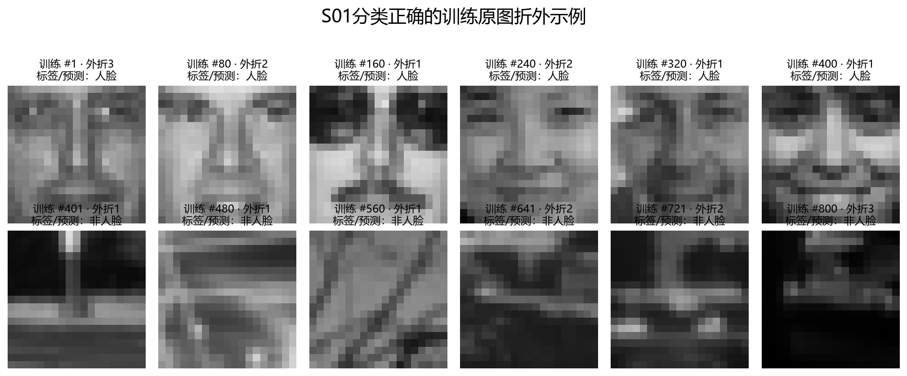

**图12**　按原图编号等间隔取正确样本，展示人脸与非人脸两类，不仅选择人脸成功案例。

### 12.2 全部原图错误

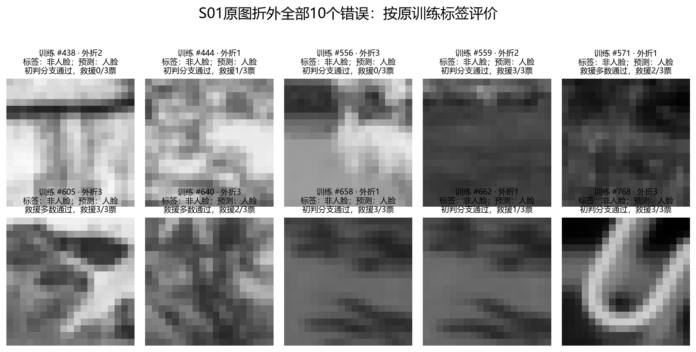

**图13**　全部10个错误，依据原训练标签评价。图中给出外折、初判/救援路径和救援票数。它们均为非人脸误报，说明粗布局、边缘或纹理可能触发人脸证据；本报告没有人工改写训练标签以消除错误。

每张图的标签、外折、初判、票数和S01判断见[逐原图决策](../evidence/S01训练原图折外决策.csv)。这些是流程评价中的对应嵌套配方，不能用最终部署组的阈值直接解释它们。

## 13. 鲁棒性分析与不确定性

### 13.1 指标与总体表现

$$
\mathrm{Acc}=\frac{\mathrm{TP}+\mathrm{TN}}N,\quad
\mathrm{Recall}=\frac{\mathrm{TP}}{\mathrm{TP}+\mathrm{FN}},\quad
\mathrm{Specificity}=\frac{\mathrm{TN}}{\mathrm{TN}+\mathrm{FP}}.
$$

| S01内部评价指标 | 结果 |
| --- | --- |
| 原图准确率 | 98.7500% |
| 标准16视图加权准确率 | 98.0833% |
| 标准16视图加权人脸召回率 | 99.2667% |
| 标准16视图加权非人脸特异度 | 96.9000% |
| 标准面板最差视图准确率 | 94.5000% |
| 4压力视图平均准确率 | 97.6875% |
| 4压力视图平均人脸召回率 | 97.5000% |
| 4压力视图平均非人脸特异度 | 97.8750% |

800原图两类平衡，所以按全部原图汇总的每视图BA与准确率相同；SEL可能为44／45类数量，阈值搜索因此明确采用BA。

### 13.2 逐退化结果

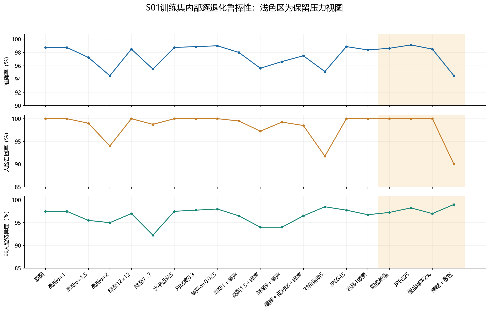

**图14**　仅展示S01。浅色区为四个保留压力条件，各行纵轴覆盖全部数据点。标准加权平均较高，并不意味着每种强退化都接近满分。

| 条件 | 准确率 | 人脸召回率 | 非人脸特异度 |
| --- | --- | --- | --- |
| 原图 | 98.7500% | 100.0000% | 97.5000% |
| 高斯σ=1 | 98.7500% | 100.0000% | 97.5000% |
| 高斯σ=1.5 | 97.2500% | 99.0000% | 95.5000% |
| 高斯σ=2 | 94.5000% | 94.0000% | 95.0000% |
| 降至12×12 | 98.5000% | 100.0000% | 97.0000% |
| 降至7×7 | 95.5000% | 98.7500% | 92.2500% |
| 水平运动5 | 98.7500% | 100.0000% | 97.5000% |
| 对比度0.3 | 98.8750% | 100.0000% | 97.7500% |
| 噪声σ=0.025 | 99.0000% | 100.0000% | 98.0000% |
| 高斯1＋噪声 | 98.0000% | 99.5000% | 96.5000% |
| 高斯1.5＋噪声 | 95.6250% | 97.2500% | 94.0000% |
| 降至9＋噪声 | 96.6250% | 99.2500% | 94.0000% |
| 模糊＋低对比＋噪声 | 97.5000% | 98.5000% | 96.5000% |
| 对角运动5 | 95.1250% | 91.7500% | 98.5000% |
| JPEG45 | 98.8750% | 100.0000% | 97.7500% |
| 右移1像素 | 98.3750% | 100.0000% | 96.7500% |
| 圆盘散焦 | 98.6250% | 100.0000% | 97.2500% |
| JPEG25 | 99.1250% | 100.0000% | 98.2500% |
| 椒盐噪声2% | 98.5000% | 100.0000% | 97.0000% |
| 模糊＋散斑 | 94.5000% | 90.0000% | 99.0000% |

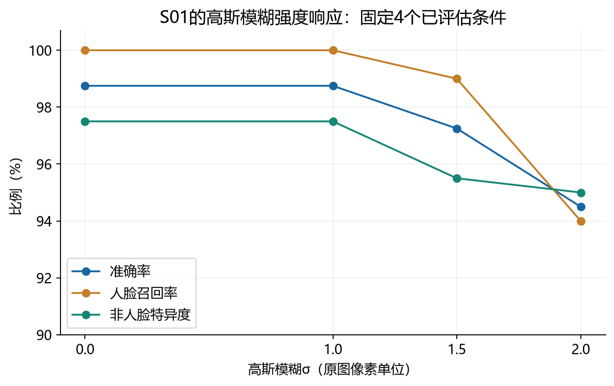

**图15**　在已测的高斯σ=0、1、1.5、2四条件中，准确率依次为98.75%、98.75%、97.25%、94.50%。σ=2时人脸召回94%，说明强模糊仍有损失；没有评估连续所有σ或更强退化，不能向外推断。

复合条件“高斯1.5＋噪声”的人脸召回为97.25%；“模糊＋低对比＋噪声”为98.50%。四压力视图中，模糊＋散斑的人脸召回为90%，是明显短板。不同条件涉及不同物理破坏，不能只用模糊强度单一数值排序。

### 13.3 同时展示退化成功与漏检

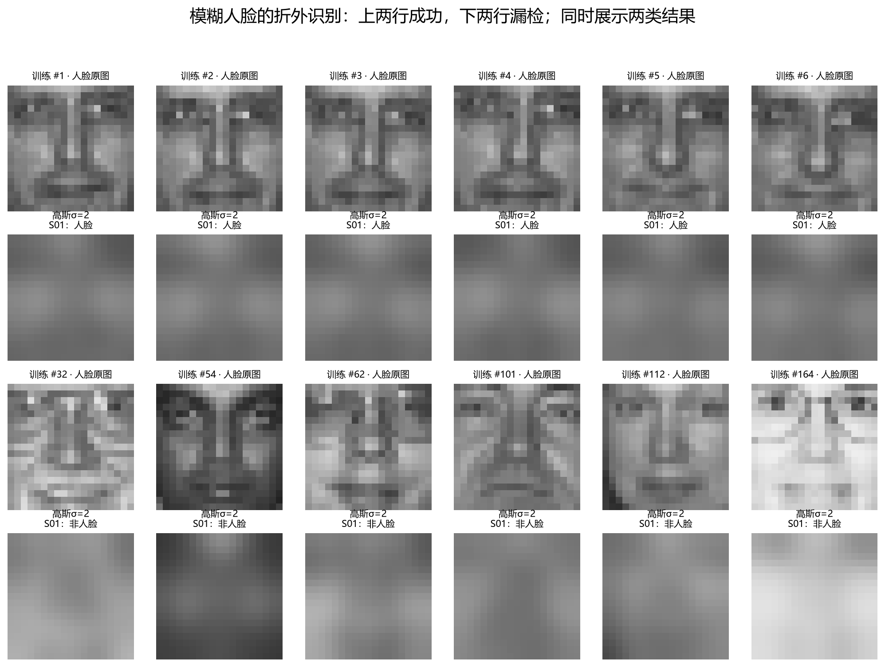

**图16**　上两行是成功案例，下两行是漏检；展示原图与实际评分的退化张量。固定噪声按原外折顺序重新生成，并与评分缓存的图像张量哈希核对，避免显示的噪声图与被分类样本不一致。

### 13.4 条件区间及其边界

以原图为聚类单位，同一原图所有视图一起重采样，按外折×类别分层，5000次、随机种子20261116，得到：

| 评价指标 | 点估计 | 条件95%区间 |
| --- | --- | --- |
| 原图准确率 | 98.7500% | [98.0000%, 99.5000%] |
| 标准加权准确率 | 98.0833% | [97.4542%, 98.6583%] |
| 压力平均准确率 | 97.6875% | [97.0000%, 98.3125%] |

这是**固定既有权重、阈值和流程后的条件区间**，不覆盖重训、超参数搜索、反复选型或数据域变化。不能把区间当作全项目无选择偏差的泛化保证。[计算记录](../evidence/S01绝对指标条件区间.json)

## 14. 消融实验：检验各部分的实际作用

### 14.1 两类消融问题

**固定删除F组**保留其他融合系数和阈值；删除家族相当于去掉其标准化特征项。它检查部署配置的敏感性。**重新校准R组**保持匹配神经权重和原图角色，仅在META重新拟合、SEL重新选阈值；它检查删改后能否恢复分类能力。

下面以S01为唯一参考。删除某个救援家族时，初判分支中的该家族仍保留；单种子对照则同时改变初判与救援的小网络，Dense种子始终42。每组均使用相同来源外折、视图和评价权重。

本轮复用已训练的匹配权重，重新前向单成员并拟合小型校准器，没有为每个删改结构重训所有剩余骨干。因此结论是**在该权重与校准协议下的组件作用**，不是架构空间的不可替代性定理。

### 14.2 核心对照与条件区间

| 组 | 处理 | 标准加权准确率 | 人脸召回率 | 非人脸特异度 | 压力平均准确率 |
| --- | --- | --- | --- | --- | --- |
| S01 | 最终完整模型 | 98.083% | 99.267% | 96.900% | 97.688% |
| F01_NO_C0 | 去初判分支，保留三组救援 | 98.283% | 98.742% | 97.825% | 97.969% |
| F02_NO_RESCUE | 去救援委员会，仅初判分支 | 98.217% | 98.542% | 97.892% | 94.250% |
| R11_NO_RESNET8 | 救援去ResNet8并重新校准 | 97.758% | 99.167% | 96.350% | 95.906% |
| R12_NO_HIRES19 | 救援去HiRes19并重新校准 | 97.821% | 99.458% | 96.183% | 97.688% |
| R13_NO_DENSENET121 | 救援去DenseNet并重新校准 | 97.983% | 99.275% | 96.692% | 97.094% |
| R14_SEED42 | 小网络仅种子42并重新校准 | 98.033% | 99.342% | 96.725% | 97.594% |
| R15_SEED7 | 小网络仅种子7并重新校准 | 97.975% | 99.308% | 96.642% | 97.844% |
| R16_SEED2026 | 小网络仅种子2026并重新校准 | 98.046% | 99.217% | 96.875% | 96.938% |
| R20_MEAN_PROB | 救援概率均值＋独立阈值 | 97.983% | 99.358% | 96.608% | 97.438% |
| R26_EQUAL_LOGIT | 救援等权logit＋独立阈值 | 98.063% | 99.300% | 96.825% | 97.656% |
| R21_RAW_LOGIT | 无融合标准化，重新校准 | 98.025% | 99.325% | 96.725% | 97.812% |
| R22_STAGE1 | 救援仅第一阶段权重并重校准 | 96.925% | 99.125% | 94.725% | 95.406% |
| R23_OLD_DEGRADE | 救援使用基础退化训练并重校准 | 97.908% | 99.075% | 96.742% | 95.062% |
| R24_NO_RIDGE | 去L2正则，重新拟合 | 97.979% | 99.317% | 96.642% | 97.562% |
| R25_SIGNED | 允许负融合系数，重新拟合 | 98.083% | 99.267% | 96.900% | 97.688% |

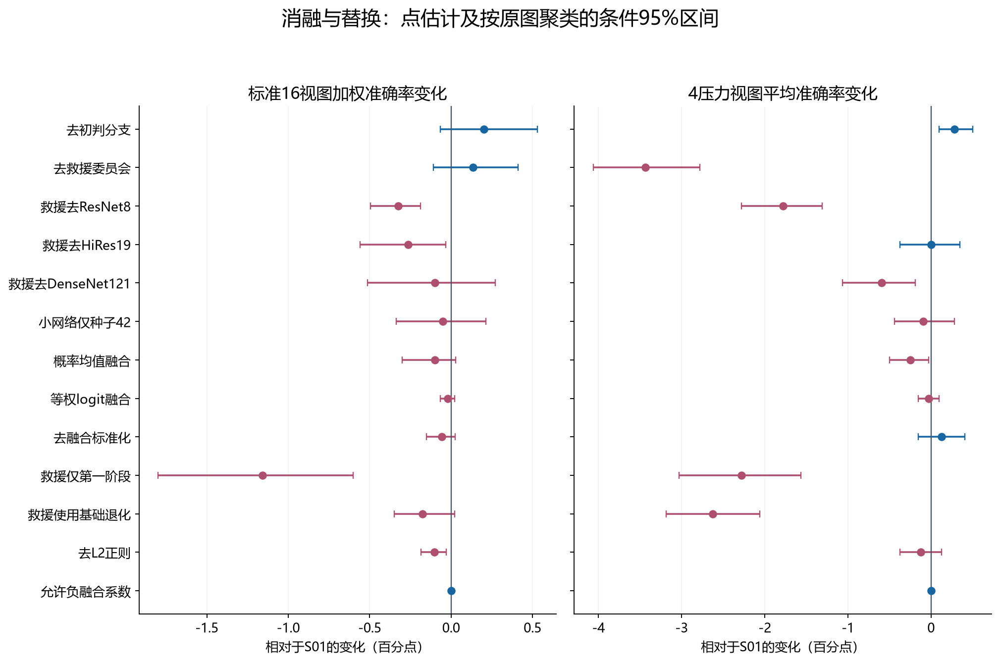

**图17**　消融相对S01的百分点变化和原图聚类条件区间，标准与压力指标同时显示，避免只选择有利指标。

| 组 | 标准Δ百分点 | 标准条件95%区间 | 压力Δ百分点 | 压力条件95%区间 |
| --- | --- | --- | --- | --- |
| F01_NO_C0 | +0.200 | [-0.067, +0.529] | +0.281 | [+0.094, +0.500] |
| F02_NO_RESCUE | +0.133 | [-0.108, +0.413] | -3.438 | [-4.063, -2.781] |
| R11_NO_RESNET8 | -0.325 | [-0.496, -0.187] | -1.781 | [-2.281, -1.312] |
| R12_NO_HIRES19 | -0.262 | [-0.558, -0.033] | +0.000 | [-0.375, +0.344] |
| R13_NO_DENSENET121 | -0.100 | [-0.512, +0.271] | -0.594 | [-1.062, -0.188] |
| R14_SEED42 | -0.050 | [-0.338, +0.213] | -0.094 | [-0.438, +0.281] |
| R15_SEED7 | -0.108 | [-0.417, +0.175] | +0.156 | [-0.188, +0.500] |
| R16_SEED2026 | -0.038 | [-0.258, +0.212] | -0.750 | [-1.219, -0.312] |
| R20_MEAN_PROB | -0.100 | [-0.300, +0.029] | -0.250 | [-0.500, -0.031] |
| R26_EQUAL_LOGIT | -0.021 | [-0.067, +0.021] | -0.031 | [-0.156, +0.094] |
| R21_RAW_LOGIT | -0.058 | [-0.150, +0.025] | +0.125 | [-0.156, +0.406] |
| R22_STAGE1 | -1.158 | [-1.800, -0.600] | -2.281 | [-3.031, -1.563] |
| R23_OLD_DEGRADE | -0.175 | [-0.350, +0.021] | -2.625 | [-3.188, -2.063] |
| R24_NO_RIDGE | -0.104 | [-0.183, -0.029] | -0.125 | [-0.375, +0.125] |
| R25_SIGNED | +0.000 | [+0.000, +0.000] | +0.000 | [+0.000, +0.000] |

这些区间条件于既有模型，未校正多重探索，也不包含重训与选型方差。它们帮助判断点估计的量级与稳定性，不能强行把每个小差异解释为必要贡献。

### 14.3 可以支持哪些作用

**第二阶段与复合退化训练的支持较强。** 救援仅使用第一阶段权重并重新校准，标准准确率下降1.158个百分点、压力平均准确率下降2.281个百分点；使用基础退化路线时压力准确率下降2.625个百分点。它们支持第二阶段复合退化训练对当前流程的作用，但差异也包括额外更新和视图损失结构，不能将收益全部归因于某个噪声参数。

**ResNet8救援家族有明确的本面板贡献。** 去掉并重新校准后，标准准确率下降0.325个百分点、压力下降1.781个百分点，条件区间均偏负。HiRes19的删除主要损害标准准确率，压力均值未下降；Dense删除的压力指标下降较明显。这说明家族提供的价值存在侧重，不能简单说每个架构都专门负责所有模糊情况。

**初判与救援承担不同取舍。** 去掉救援，压力平均准确率降至94.25%；去掉初判，平均准确率有所上升，但人脸召回下降0.525个百分点，最差标准视图下降2.375个百分点。初判的作用是保留其正判断和提供早期退出，其误报也会被保留，不能称为所有指标都必需。

**三种子与可学习融合的不可替代性证据不足。** 单种子42的标准损失仅0.05个百分点，等权logit替代的损失仅0.02083个百分点，两者标准和压力条件区间均跨0。因此现有数据不足以证明三个种子或可学习融合系数必不可少。保留最终配置不等于应把这些不确定性写成已验证收益。

**非负约束与标准化有明确功能，但必要性尚未单独证明。** 非负约束规定证据方向；本轮允许负系数后，各拟合系数仍为正，全部源判断未变，说明约束没有在已拟合解上触界。去标准化并重新校准也没有显示一致劣势；标准化会影响L2所处尺度，但不能据此宣称没有它模型就无效。

**L2正则在标准面板有小幅支持。** 去掉后标准准确率下降约0.104个百分点，其条件区间偏负；压力平均下降0.125个百分点，但该条件区间跨0。它与限制小样本融合系数规模的设计动机一致，仍不能说明0.01已是最佳正则强度，或正则对每种退化都必需。

**共享与条件执行的作用由结构说明。** 共享模块提供公共特征；短路依据逻辑充分条件跳过后续成员。它们不是通过提高准确率来证明价值的模块。S01中这些实现规则的依据在第5、9、10节给出。

### 14.4 尚未单独验证的部分

没有新做去掉第一阶段、直接从初始化进行第二阶段的匹配总更新实验；也没有逐项重训消融每个GroupNorm、膨胀率、池化区间和增强算子。因此不能在本报告宣称上述每个设置均已被证明必要。

### 14.5 固定删除与重新校准的完整结果

下表保留全部F/R记录，分别说明固定删改与恢复校准。它们是S01的消融变体，不作为额外最终模型选型。

| 组 | 删改内容 | 标准准确率 | 人脸召回 | 非人脸特异度 | 压力准确率 |
| --- | --- | --- | --- | --- | --- |
| F01_NO_C0 | 删除初判分支 | 98.283% | 98.742% | 97.825% | 97.969% |
| F02_NO_RESCUE | 删除整个救援委员会 | 98.217% | 98.542% | 97.892% | 94.250% |
| F03_NO_PAIR1 | 删除救援组1，剩余两组均同意才救援 | 98.275% | 99.117% | 97.433% | 97.156% |
| F04_NO_PAIR2 | 删除救援组2，剩余两组均同意才救援 | 98.125% | 99.175% | 97.075% | 97.125% |
| F05_NO_PAIR3 | 删除救援组3，剩余两组均同意才救援 | 98.292% | 99.175% | 97.408% | 97.281% |
| F06_ONLY_PAIR1 | 只保留救援组1 | 97.925% | 99.350% | 96.500% | 97.188% |
| F07_ONLY_PAIR2 | 只保留救援组2 | 98.146% | 99.217% | 97.075% | 97.594% |
| F08_ONLY_PAIR3 | 只保留救援组3 | 97.792% | 99.258% | 96.325% | 97.219% |
| F09_ANY_VOTE | 救援改为至少1票 | 97.475% | 99.458% | 95.492% | 97.375% |
| F10_ALL_VOTES | 救援改为3票一致 | 98.304% | 99.100% | 97.508% | 96.938% |
| F11_NO_RESNET8 | 救援删除resnet8，其余系数阈值固定 | 97.029% | 99.408% | 94.650% | 95.938% |
| R11_NO_RESNET8 | 救援删除resnet8后独立重新校准 | 97.758% | 99.167% | 96.350% | 95.906% |
| F12_NO_HIRES19 | 救援删除hires19，其余系数阈值固定 | 97.638% | 99.542% | 95.733% | 97.656% |
| R12_NO_HIRES19 | 救援删除hires19后独立重新校准 | 97.821% | 99.458% | 96.183% | 97.688% |
| F13_NO_DENSENET121 | 救援删除densenet121，其余系数阈值固定 | 97.112% | 99.442% | 94.783% | 96.656% |
| R13_NO_DENSENET121 | 救援删除densenet121后独立重新校准 | 97.983% | 99.275% | 96.692% | 97.094% |
| F14_SEED42 | 全部小网络仅种子42，融合固定 | 98.046% | 99.342% | 96.750% | 97.625% |
| R14_SEED42 | 全部小网络仅种子42，救援重新校准 | 98.033% | 99.342% | 96.725% | 97.594% |
| F15_SEED7 | 全部小网络仅种子7，融合固定 | 97.954% | 99.292% | 96.617% | 97.875% |
| R15_SEED7 | 全部小网络仅种子7，救援重新校准 | 97.975% | 99.308% | 96.642% | 97.844% |
| F16_SEED2026 | 全部小网络仅种子2026，融合固定 | 98.079% | 99.200% | 96.958% | 97.156% |
| R16_SEED2026 | 全部小网络仅种子2026，救援重新校准 | 98.046% | 99.217% | 96.875% | 96.938% |
| F17_DROP_SEED42 | 全部小网络删除种子42 | 98.033% | 99.258% | 96.808% | 97.469% |
| F18_DROP_SEED7 | 全部小网络删除种子7 | 97.996% | 99.300% | 96.692% | 97.375% |
| F19_DROP_SEED2026 | 全部小网络删除种子2026 | 98.033% | 99.292% | 96.775% | 97.719% |
| F20_MEAN_PROB | 救援概率平均，既有阈值固定 | 97.613% | 99.425% | 95.800% | 97.188% |
| R20_MEAN_PROB | 救援概率平均，独立重选阈值 | 97.983% | 99.358% | 96.608% | 97.438% |
| F21_RAW_LOGIT | 取消标准化，既有系数阈值固定 | 98.229% | 99.258% | 97.200% | 97.531% |
| R21_RAW_LOGIT | 取消标准化后重新拟合与选阈值 | 98.025% | 99.325% | 96.725% | 97.812% |
| F22_STAGE1 | 救援删去第二阶段，既有融合固定 | 98.217% | 98.542% | 97.892% | 94.250% |
| R22_STAGE1 | 救援删去第二阶段后重新校准 | 96.925% | 99.125% | 94.725% | 95.406% |
| F23_OLD_DEGRADE | 救援替换为基础退化策略，融合固定 | 98.083% | 98.733% | 97.433% | 94.844% |
| R23_OLD_DEGRADE | 救援替换为基础退化策略后重校准 | 97.908% | 99.075% | 96.742% | 95.062% |
| R24_NO_RIDGE | 融合去掉L2正则，重新拟合 | 97.979% | 99.317% | 96.642% | 97.562% |
| R25_SIGNED | 融合允许负系数，重新拟合 | 98.083% | 99.267% | 96.900% | 97.688% |
| R26_EQUAL_LOGIT | 用等权logit替代可学习融合，独立选阈值 | 98.063% | 99.300% | 96.825% | 97.656% |

## 15. 模型优点、局限与适用边界

### 15.1 优点

- **输入与结构互补**：原生低分辨率残差、高网格布局和监督迁移/强度路径提供不同类型的证据。
- **复合退化训练有实测支持**：在固定原图角色和内部评价下，对救援阶段训练路线的消融显示较明显压力损失。
- **共享特征与条件执行明确**：公共冻结参数只保存一份；执行路径由已经足够决定最终标签的逻辑条件确定。
- **分数融合容量有限**：每组仅拟合三个系数与截距，具有正则和边界，校准来源可追踪。
- **数据角色可核对**：原图先分角色、视图随后生成，ES、META、SEL各自用途清楚，代码和权重有哈希记录。

### 15.2 局限

- **初判误报无法由救援纠正**，高召回逻辑可能增加非人脸误报；原图流程评价仍有10个误报。
- **强模糊与复合噪声仍有漏检**，19×19的信息损失可能不可逆；某些退化人脸只剩不足以区分的结构。
- **融合权重对输入固定**，条件执行不是学习图像质量后挑选专家；某个家族持续自信犯错时，静态融合仍可能失败。
- **校准样本较少**，每组SEL只有89张独立原图，长小数不能体现阈值统计稳定性。
- **部署与流程评价样本规模不同**，又存在同一训练数据上的历史开发与反复探索，不能把内部成绩当作完整独立泛化结论。
- **模拟退化覆盖有限**，未全面检验姿态、遮挡、非对齐和所有噪声机制；没有给最终逻辑输出认证概率解释。
- **模型仍有28个评分成员**，共享参数与短路不能保证所有设备上相同的吞吐或延迟；本文没有提供受控硬件benchmark。
- **部分组件必要性证据不足**，本报告保留这些结论，不以固定模型选择替代实验论证。

## 16. 关键代码、复核材料与使用

| 材料 | 内容 |
| --- | --- |
| [S01实际运行器](../archive/code/c1_shared_runtime.py) | 共享前缀、独立尾部、float32/64数值规则和条件执行 |
| [网络与预处理](../archive/code/networks.py) | ResNet8、HiRes19及输入转换 |
| [专家训练代码](../archive/code/a1_a4_experiment.py) | 两阶段权重、复合退化与记录；文件还含未启用的其他分支 |
| [融合与角色代码](../archive/code/c_rescue_experiment.py) | META拟合、原图角色与配对；文件还含其他实验 |
| [精确阈值搜索](../archive/code/b1_b4_experiment.py) | 候选分区扫描与同分规则 |
| [最终模型身份](../evidence/S01部署模型身份.json) | 实际权重位置、哈希、参数量与部署边际 |
| [逐视图结果](../evidence/S01逐退化视图指标.csv) | 全部20条件的准确率、召回率与特异度 |
| [完整超参数账本](../evidence/超参数完整账本.md) | 固定、拟合、内部选择、继承设置的区分 |
| [字体核验](../evidence/报告图像字体核验.json) | 数据与曲线图的微软雅黑来源；结构图另附字体记录 |

以下为真实运行器提供的Python接口。模型文件、`metadata.json`、运行器和`networks.py`放在同一模型目录；图像恢复方式必须与训练一致：

```python
from c1_shared_runtime import SharedRuntime
model = SharedRuntime(model_dir,device='cpu')  # 或 device='mps'
labels, stats = model.predict(images_cpu_float32_N1x19x19)
```

报告图文包不含大型神经权重；运行器代码快照保留导出功能的工作区路径，推理从显式传入的模型目录读取便携文件。报告生成需要原工作区数据与已有单成员源评分缓存。所有训练与评价数字均可通过随附记录追溯，不用全量拟合后的训练准确率冒充折外结果。

## 17. 参考依据

本模型具体参数、成绩和训练过程以实际代码、权重、分折和日志为依据。文献支持机制与术语，不替代本任务的实验：

- He等，[Deep Residual Learning for Image Recognition](https://arxiv.org/abs/1512.03385)：残差学习。
- Huang等，[Densely Connected Convolutional Networks](https://arxiv.org/abs/1608.06993)：密集特征复用。
- Wu、He，[Group Normalization](https://arxiv.org/abs/1803.08494)：按通道分组归一化。
- Guo等，[On Calibration of Modern Neural Networks](https://arxiv.org/abs/1706.04599)：分类分数与概率校准的区别；S01没有把最终逻辑输出称为已认证的概率。
